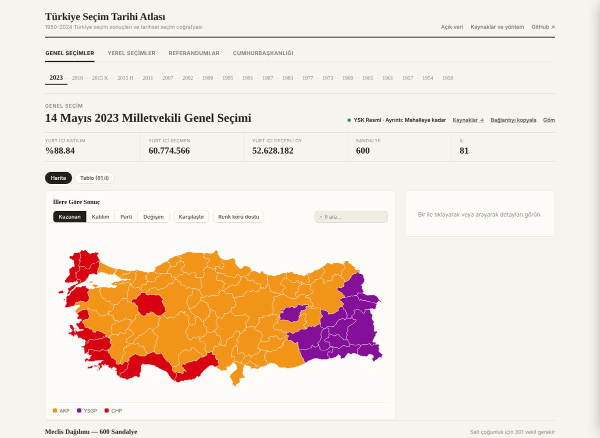
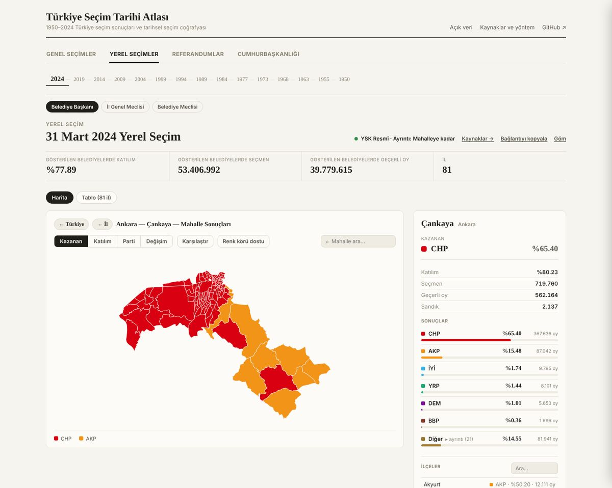
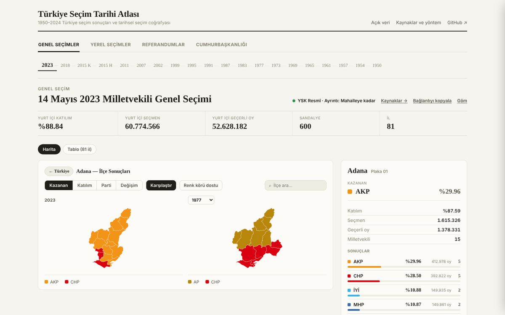
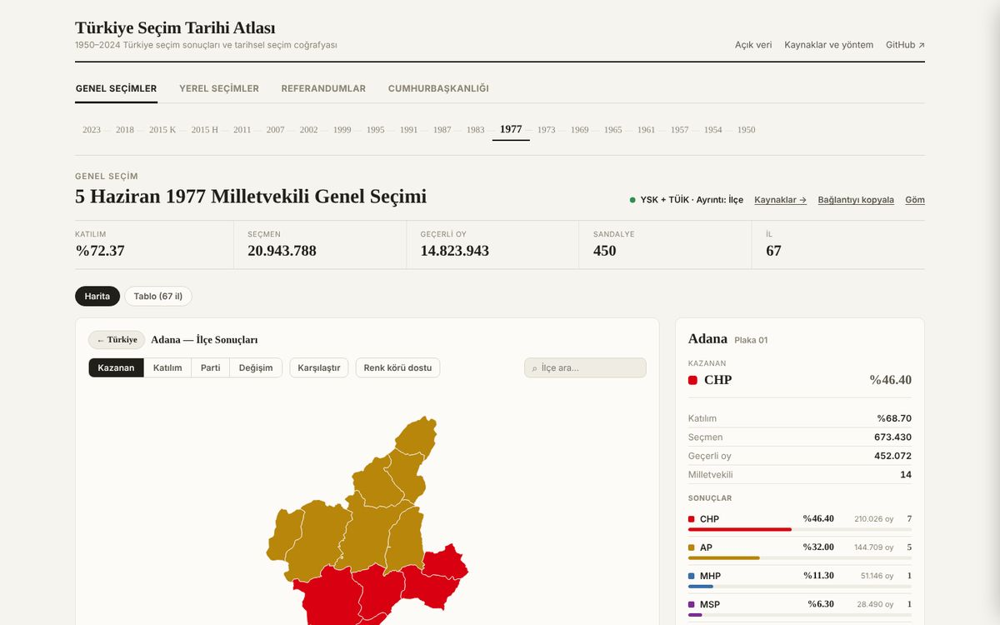
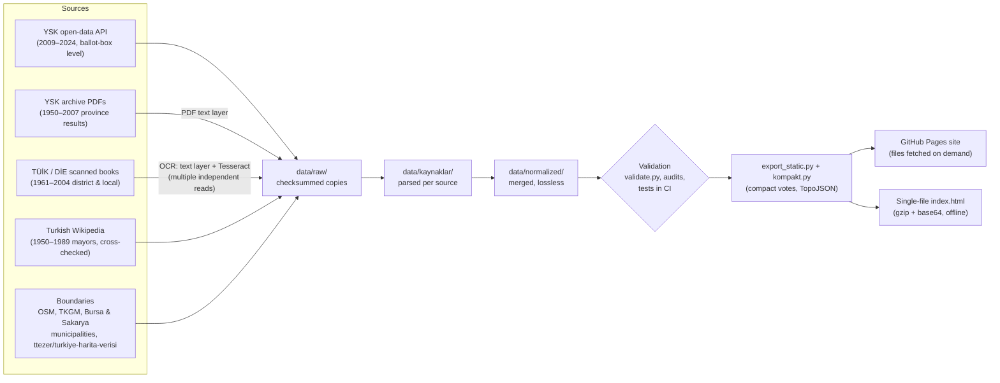

# Türkiye Election Map

*[Türkçe](README.md) | English*

An interactive map and open dataset of every Turkish election from 1950 to 2024: general elections,
local elections, presidential elections and referendums, at province and district level, and at
neighbourhood level from 2009 onwards. Each election is drawn with the province and district
boundaries that existed on its own date.

**Live demo:** https://hamikumbasae.github.io/turkiye-secim-haritasi/
| **Open data:** [veri.html](https://hamikumbasae.github.io/turkiye-secim-haritasi/veri.html)
| **Methodology (Turkish):** [yontem.html](https://hamikumbasae.github.io/turkiye-secim-haritasi/yontem.html)



## Why

Turkish election results are public, but they are scattered across API endpoints, per-province PDFs and
scanned statistical yearbooks, each with its own district names and boundaries. Comparing a district in 1977
with the same place in 2023 means reconciling all of them by hand. This project does that reconciliation
once, records where every number came from, and puts the result on a map that anyone can open in a browser.

## Key numbers

| | |
|---|---|
| Elections covered | **46** (1950–2024): 20 general, 15 local, 7 referendums, 4 presidential |
| Levels | province and district for every election (district from 1961 for general elections); neighbourhood for 15 elections, 2009–2024 |
| Neighbourhood results | **602,285** across those 15 elections |
| Neighbourhood boundaries | **51,301** polygons |
| Vote rows | **~2.8 million** |
| Share of voters placed on a neighbourhood polygon | 93–94% for 2014–2024, 87–88% for 2009–2011 |
| Offline build | the whole site and data in one `index.html` (~38 MB), attached to each release |

## Features

- **Map modes:** winner, turnout, party vote share and swing (percentage-point change from the previous election of the same type).
- **Election history:** click a province or district in a general election to see its curve across all general elections.
- **Compare:** two elections side by side with synchronised zoom.
- **Embed:** an iframe snippet for the current view (`&gom=1`, optional `&tema=acik|koyu`).
- **Shareable links:** election, province, district, neighbourhood, mode and party live in the URL hash.
- **Open data:** per-election CSVs (province + district, neighbourhood, councils), JSON, a bulk zip and `SHA256SUMS`.
- **Accessibility:** colour-blind-safe palette (Okabe–Ito), keyboard navigation, screen-reader labels.

| Neighbourhood level (2024 local, Çankaya) | Historical boundaries side by side (Adana, 2023 vs 1977) |
|---|---|
|  |  |



## Data pipeline

Data flows in one direction. No number is ever fixed by hand in the site's HTML: a correction is made in
the layer closest to the source, and the pipeline is re-run.



How each era is collected:

| Route | Elections | Code |
|---|---|---|
| YSK open-data API | 2009–2024 general, local, presidential; 2010 and 2017 referendums | `scripts/pipelines/election_import/` |
| YSK archive PDFs (text layer) | 1950–2007 general elections by province; 1994–2004 local | `scripts/pipelines/genel_1950_1977/`, `genel_1983_2007/`, `yerel_1994_1999_2004/` |
| TÜİK election distribution reports | 1961–1987 general elections by district | `scripts/pipelines/genel_ilce_1961_1987/` |
| DİE scanned books (OCR) | 1963–2004 local elections; 1961–1988 referendums | `scripts/pipelines/tuik_arsiv/` |
| YSK API, ballot box to neighbourhood | 15 elections, 2009–2024 | `scripts/pipelines/mahalle_veri/` (Node + Playwright; runs in GitHub Actions) |
| Historical district boundaries | every election | `scripts/pipelines/historical_geo/tarihsel_sinirlari_uret.py` |

Neighbourhood results are matched to polygons in a fixed order (municipality data, existing match,
OpenStreetMap, TKGM, OSM place points), and re-running the matcher is reproducible.

## Validation approach

The rule is simple: **values are kept exactly as the source printed them.** If a source contradicts itself,
the value is not changed; the discrepancy is shown on the site, in the CSV `not` column and in
[`docs/rapor/VERI_DENETIMI.md`](docs/rapor/VERI_DENETIMI.md). Manual corrections are made only when the
evidence is conclusive, and the old value is kept in the record.

**Cross-source checks** (examples from [`docs/rapor/VERI_VE_YONTEM.md`](docs/rapor/VERI_VE_YONTEM.md)):

- 1994 and 1999 local elections, OCR'd mayor rows vs the YSK archive: 1,668/1,668 and 1,815/1,815 rows identical.
- 1983–2007 general elections, seats per province vs YSK summaries: 528 of 529 records identical (the exception is internally inconsistent in the YSK document itself).
- 1999 provincial councils: a column shift affecting 72/72 provinces was caught and fixed; afterwards 72/72 match.

**OCR rules for scanned books:** several independent reads per cell (PDF text layer, Tesseract and, for 1984,
also macOS Vision and visual reading of cropped strips); a row is accepted only if its totals, percentages
and turnout check out; missing cells are never back-filled from totals; fuzzy name matching is allowed only
above a similarity threshold and in book order.

**Automated checks** run on every push and pull request through
[`.github/workflows/validate.yml`](.github/workflows/validate.yml):

| Check | Command |
|---|---|
| Structural validation (stops the build) | `python3 scripts/validate.py` |
| Published data | `python3 scripts/validate_public_data.py` |
| Data audit (fails on any new finding) | `python3 scripts/veri_denetimi.py --kontrol docs/rapor/veri_denetimi` |
| Analytical checks: checksums, seat totals, winner records, history completeness, byte-for-byte reproducible build | `python3 tests/validate_elections.py` |
| Node data-integrity tests | `node --test tests/*.test.cjs` |
| Browser tests (loading, history, compare, embed, CSV) | `cd site && npm ci && npm test` |

Known limits (e.g. 1950–1957 general elections exist only at province level) are listed in the
[Turkish README](README.md#kapsam-sınırları) and in [`docs/rapor/KAPSAM_TABLOSU.md`](docs/rapor/KAPSAM_TABLOSU.md).

## Sources and licensing

Primary sources are official: **YSK** (Supreme Election Council) open data and archive PDFs, and **TÜİK/DİE**
(Turkish Statistical Institute) archive books. Wikipedia and community datasets are used only where no official
source exists, and are cross-checked wherever possible. Boundaries come from **OpenStreetMap**, **TKGM**
(General Directorate of Land Registry and Cadastre), the **Bursa and Sakarya** metropolitan municipalities and
`ttezer/turkiye-harita-verisi`. Full list: [`SOURCES.md`](SOURCES.md) and the machine-readable
[`sources.yml`](sources.yml). To trace a single value: `python3 scripts/kaynak.py 1995 İstanbul Fatih`.

- **Code:** MIT ([LICENSE](LICENSE)).
- **Data:** CC BY-SA 4.0. OpenStreetMap-derived boundaries are ODbL (© OpenStreetMap contributors); Bursa and
  Sakarya boundaries follow their municipal open-data licences; TKGM boundaries are outside this licence.
  Details: [LICENSE-DATA.md](LICENSE-DATA.md).

## Tech stack

- **Data processing:** Python 3.13 (`pyyaml`, `shapely`), Tesseract OCR, Node.js scripts for the YSK API
- **Automation:** 14 GitHub Actions workflows (data fetchers, validation, Pages deploy, single-file release)
- **Front end:** plain JavaScript and SVG, no map library; lossless TopoJSON boundaries and compact vote arrays
  decoded in the browser with `DecompressionStream`
- **Testing:** Python analytical checks, `node --test`, Playwright browser tests
- **Hosting:** GitHub Pages; offline single-file build attached to every release

## Repository layout

```
data/raw/            Checksummed raw copies of external sources (YSK, TÜİK, Official Gazette, secondary sources)
data/kaynaklar/      Data parsed per source, so every value can be traced back
data/normalized/     What the site reads: elections/<type>/<election>.json, mahalle/, meclis_harita/, ek/
geo/normalized/      Current province, district and neighbourhood boundaries
geo/historical/      Historical province/district boundaries and district mapping tables
site/                Front end (src/), Pages build (build.py -> site/dist/), browser tests
scripts/             Publishing, validation, audits and data pipelines (pipelines/)
tests/               Analytical validation, Node and browser tests
docs/rapor/          Coverage table, data audit, matching and methodology reports
```

Every data folder has its own `PROVENANCE.md`.

## Running locally

```bash
pip install -r requirements.txt          # pyyaml, shapely (Python 3.13)
python3 site/build.py                    # writes site/dist/
python3 -m http.server -d site/dist 8000 # http://localhost:8000
python3 scripts/build.py                 # optional: single-file offline index.html
```

## Roadmap

v1.0 of the map and dataset is complete. Work in progress, not yet merged into `main`:

- **Database:** loading all election data into MariaDB on a Raspberry Pi home server.
- **REST API:** a Spring Boot backend serving the data.
- **Chatbot:** an LLM assistant that turns natural-language questions into SQL over the database.

New elections are added when they happen (next scheduled: 2028 general, 2029 local).

## Author

Hami Kumbasar, computer engineer, Istanbul. [github.com/hamiKumbasae](https://github.com/hamiKumbasae)
