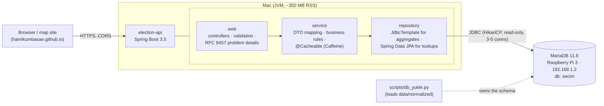

# Türkiye Election API

A read-only REST API over **every Turkish general, local and presidential election and referendum from
1950 to 2024**: 46 elections, about 640,000 result units (provinces, districts, neighbourhoods, abroad) and
2.8 million vote rows. It serves the data behind the
[Türkiye Seçim Haritası](https://hamikumbasae.github.io/turkiye-secim-haritasi/) map: national totals,
province, district and neighbourhood results, a party's history in one place, top-N rankings, name search
and neighbourhood boundaries as GeoJSON.

**Stack:** Java 21, Spring Boot 3.5 (Web MVC, Data JPA, JdbcTemplate, Validation, Cache, Actuator),

> **election-api-lite vs. `backend/`:** `backend/` is the full Docker setup (MySQL 8, data-loader, gateway, election-api microservices). This module is a single, standalone service that reads the same data from a MariaDB database (e.g. on a Raspberry Pi, loaded with `scripts/db_yukle.py`). The two are built and tested separately.

Caffeine, springdoc-openapi (Swagger UI), MariaDB, JUnit 5, Mockito, MockMvc, JaCoCo, Docker, GitHub Actions.

```bash
curl -s localhost:8080/api/v1/elections/2023/provinces/34 | jq '.results[0]'
# { "party": "AK Parti", "votes": 3570227, "share": 35.43, "seats": 40 }
```

## Contents

- [Architecture](#architecture)
- [Endpoints](#endpoints)
- [Running it](#running-it)
- [Tests](#tests)
- [Technical decisions](#technical-decisions)
- [Data notes](#data-notes)
- [Hızlı başlangıç (Türkçe)](#hızlı-başlangıç-türkçe)

## Architecture



| Layer | Package | Responsibility |
|---|---|---|
| Web | `web` | REST controllers, request validation (`@Min`, `@Pattern`, ...), OpenAPI annotations, global exception handler returning `application/problem+json` |
| Service | `service` | Resolving election codes, computing national totals and shares, ranking rules, caching |
| Repository | `repository` | SQL over the existing tables. `JdbcTemplate` where aggregation is clearer in SQL; Spring Data JPA (`Election`, `NeighbourhoodGeometry`) for simple entity lookups |
| DTO | `dto` | Immutable Java records; the JSON contract is English and independent of the Turkish column names |

The database schema is created and owned by [`scripts/db_yukle.py`](../../scripts/db_yukle.py). The API
never writes and never runs DDL (`ddl-auto: none`, read-only connection pool).

| Table | Rows | Used for |
|---|---|---|
| `secim` | 46 | election catalogue (`kod` is the public id, e.g. `2023`, `2024yerel`, `2017referandum`, `2023cb1tur`) |
| `birim` | 640k | one row per unit and election: `seviye` = il / ilce / mahalle / yurtdisi |
| `oy` | 2.8M | votes per party/candidate/option of a unit |
| `mahalle` | 51k | neighbourhood name and GeoJSON boundary |

## Endpoints

Everything is under `/api/v1`. Interactive docs: **`/swagger-ui.html`**, OpenAPI JSON: `/v3/api-docs`.

| Method & path | What it returns | Example |
|---|---|---|
| `GET /elections` | Elections, chronological; filter `type` (general, local, presidential, referendum; Turkish names work too) and `year` | `/elections?type=general&year=2023` |
| `GET /elections/{code}` | One election | `/elections/2017referandum` |
| `GET /elections/{code}/summary` | National totals by party (province rows + abroad), cached | `/elections/2023/summary` |
| `GET /elections/{code}/provinces` | All provinces: turnout, winner, seats | `/elections/2024yerel/provinces` |
| `GET /elections/{code}/provinces/{plate}` | One province with full party breakdown | `/elections/2023/provinces/34` |
| `GET /elections/{code}/provinces/{plate}/districts` | Districts of a province | `/elections/2023/provinces/34/districts` |
| `GET /elections/{code}/districts/{geomId}` | One district with party breakdown | `/elections/2023/districts/TR-D-34-037` |
| `GET /elections/{code}/districts/{geomId}/neighbourhoods` | Neighbourhood results, paged (`page`, `size` up to 500); 2009 onwards | `/elections/2023/districts/TR-D-34-037/neighbourhoods?size=50` |
| `GET /elections/{code}/abroad` | Votes cast abroad (2014 onwards) | `/elections/2023/abroad` |
| `GET /history` | A party in one province (`plate`) or one of its districts (`district` name) across elections; `type` filter | `/history?party=AK Parti&plate=34&district=Ümraniye` |
| `GET /elections/{code}/rankings/turnout` | Top/bottom N by turnout; `level`, `plate` or `district` scope, `order`, `minVoters`, `limit` | `/elections/2023/rankings/turnout?level=district&limit=10` |
| `GET /elections/{code}/rankings/party` | Strongest/weakest units for a party by share | `/elections/2023/rankings/party?party=CHP&level=province` |
| `GET /search` | Places by name, case- and Turkish-letter-insensitive; `level`, `election`, paging | `/search?q=umraniye` |
| `GET /geo/districts/{geomId}/neighbourhoods` | GeoJSON FeatureCollection of a district's neighbourhoods; `election=` adds winner, share, turnout to each feature | `/geo/districts/TR-D-34-037/neighbourhoods?election=2023` |
| `GET /geo/districts/{geomId}/neighbourhoods/{id}` | One neighbourhood boundary as a GeoJSON Feature | `/geo/districts/TR-D-34-037/neighbourhoods/tTR-Y-34-037-M-0002` |
| `GET /actuator/health` | Liveness/readiness and database status | |

### Examples

All responses below are real output against the full dataset (lists shortened).

**National summary**

```bash
curl -s localhost:8080/api/v1/elections/2023/summary
```
```json
{
  "election": { "code": "2023", "type": "general", "name": "14 Mayıs 2023", "year": 2023,
                "date": "2023-05-14", "totalSeats": 600 },
  "registeredVoters": 64190652,
  "validVotes": 54297147,
  "turnout": 86.75,
  "provinces": 81,
  "includesAbroad": true,
  "results": [
    { "party": "AK Parti", "votes": 19127097, "share": 35.23, "seats": 268 },
    { "party": "CHP",      "votes": 13637794, "share": 25.12, "seats": 169 }
  ]
}
```

**A province by plate code**

```bash
curl -s localhost:8080/api/v1/elections/2023/provinces/34
```
```json
{
  "electionCode": "2023", "level": "province", "plateCode": 34, "name": "İstanbul",
  "registeredVoters": 11367598, "validVotes": 10075874, "ballotBoxes": 30849,
  "turnout": 90.53, "winner": "AK Parti", "seats": 98,
  "results": [
    { "party": "AK Parti",  "votes": 3570227, "share": 35.43, "seats": 40 },
    { "party": "CHP",       "votes": 2848069, "share": 28.27, "seats": 31 },
    { "party": "İYİ Parti", "votes": 821520,  "share": 8.15,  "seats": 8 }
  ]
}
```

**"How did AK Parti do in Ümraniye over time?"** District boundaries were redrawn twice, so the district has
three geometry ids over the years; history matches by name within the province and reports the id used in
each election.

```bash
curl -s "localhost:8080/api/v1/history?party=AK%20Parti&plate=34&district=umraniye&type=general"
```
```json
{
  "party": "AK Parti", "level": "district", "plateCode": 34, "place": "Ümraniye",
  "points": [
    { "electionCode": "2002", "type": "general", "date": "2002-11-03", "votes": 140135, "share": 44.56,
      "rank": 1, "winner": "AK Parti", "geomId": "HIST-Istanbul-Umraniye-9208" },
    { "electionCode": "2011", "type": "general", "date": "2011-06-12", "votes": 207567, "share": 57.84,
      "rank": 1, "winner": "AK Parti", "geomId": "TR-D-34-037" },
    { "electionCode": "2023", "type": "general", "date": "2023-05-14", "votes": 191623, "share": 39.95,
      "rank": 1, "winner": "AK Parti", "geomId": "TR-D-34-037" }
  ]
}
```

**Rankings**

```bash
curl -s "localhost:8080/api/v1/elections/2023/rankings/party?party=CHP&limit=2"
```
```json
[
  { "rank": 1, "level": "province", "plateCode": 39, "name": "Kırklareli", "value": 45.60, "votes": 118732, "winner": "CHP" },
  { "rank": 2, "level": "province", "plateCode": 35, "name": "İzmir",      "value": 41.06, "votes": 1247915, "winner": "CHP" }
]
```

**Search** (`umraniye`, `ÜMRANİYE` and `Ümraniye` give the same result)

```bash
curl -s "localhost:8080/api/v1/search?q=umraniye&size=1"
```
```json
{
  "content": [
    { "level": "district", "plateCode": 34, "name": "Ümraniye", "geomId": "TR-D-34-037",
      "firstYear": 2009, "lastYear": 2024,
      "elections": ["2009yerel", "2010referandum", "2011", "...", "2023", "2023cb2tur", "2024yerel"] }
  ],
  "page": 0, "size": 1, "totalElements": 4, "totalPages": 4
}
```

**GeoJSON for a choropleth** (`Content-Type: application/geo+json`)

```bash
curl -s "localhost:8080/api/v1/geo/districts/TR-D-34-037/neighbourhoods?election=2023"
```
```json
{
  "type": "FeatureCollection",
  "features": [
    { "type": "Feature", "id": "tTR-Y-34-037-M-0001",
      "geometry": { "type": "Polygon", "coordinates": [[[29.1599, 41.0227], "..."]] },
      "properties": { "geomId": "tTR-Y-34-037-M-0001", "districtGeomId": "TR-D-34-037",
                      "name": "ADEM YAVUZ MAH.", "election": "2023", "hasResult": true,
                      "winner": "AK Parti", "winnerShare": 50.14, "turnout": 91.08,
                      "registeredVoters": 12263, "validVotes": 10935 } }
  ]
}
```

**Errors** are [RFC 9457](https://www.rfc-editor.org/rfc/rfc9457) problem details:

```bash
curl -s localhost:8080/api/v1/elections/2023/provinces/99
```
```json
{ "type": "about:blank", "title": "Bad request", "status": 400,
  "detail": "plate: must be less than or equal to 81", "instance": "/api/v1/elections/2023/provinces/99" }
```

| Status | When |
|---|---|
| 400 | invalid parameter (plate outside 1-81, page size > 500, unknown `level`/`type`, query shorter than 2 characters, ranking scope that does not make sense) |
| 404 | unknown election code, or no data for that place in that election (e.g. neighbourhoods before 2009, abroad before 2014) |
| 503 | the database is unreachable |

## Running it

Requirements: Java 21 and Maven 3.9 (or Docker), and network access to the `secim` database.
Credentials are always read from the environment (`DB_PASSWORD`, optional `DB_USER`, default `hami`).

| Profile | Database | Use |
|---|---|---|
| `local` (default) | `127.0.0.1:3306` | a MariaDB on the same machine |
| `pi` | `192.168.1.2:3306` | the Raspberry Pi on the home network |

`DB_HOST`, `DB_PORT`, `DB_NAME` and `PORT` override any of these.

```bash
cd backend/election-api-lite
export DB_PASSWORD='...'
mvn spring-boot:run -Dspring-boot.run.profiles=pi
# or: mvn -DskipTests package && java -jar target/election-api-lite.jar --spring.profiles.active=pi
open http://localhost:8080/swagger-ui.html
```

**Recommended once per database load:** apply the optional indexes (additive, nothing else changes; re-apply
after `db_yukle.py` reloads, since it recreates the tables):

```bash
mariadb -h 192.168.1.2 -u hami -p secim < sql/indexes.sql
```

| Query | Without | With [`sql/indexes.sql`](sql/indexes.sql) |
|---|---|---|
| `/history` for a province | ~0.1 s | ~0.01 s |
| `/search` (contains, grouped) | ~0.8 s | ~0.4 s |

Everything else is served by the indexes `db_yukle.py` already creates, typically in 10-50 ms
uncached and ~5 ms from cache.

**Docker** (`Dockerfile` is multi-stage: Maven build, then a JRE-only image with layered jar, non-root user):

```bash
cp .env.example .env        # set DB_PASSWORD
docker compose up --build   # SPRING_PROFILES_ACTIVE=pi by default
```

On Docker Desktop for Mac a container reaches `192.168.1.2` directly; use `DB_HOST=host.docker.internal`
for a database on the Mac itself.

## Tests

```bash
mvn verify                                    # unit + web tests; DB integration tests skip themselves
DB_PASSWORD='...' mvn verify                  # + integration tests against 127.0.0.1
DB_HOST=192.168.1.2 DB_PASSWORD='...' mvn verify   # + integration tests against the Pi
```

| Kind | Classes | What they cover |
|---|---|---|
| Unit (Mockito) | `*ServiceTest`, `ElectionDatesTest`, `LevelAndTypeTest`, `RowsTest` | share calculation, chronological ordering, zero-vote filtering, ranking scope rules, paging maths, Turkish date parsing, Turkish letter folding, LIKE escaping |
| Web slice (`@WebMvcTest`) | `*ControllerTest` | JSON contract, validation (400), problem details (404/503), enum parsing in English and Turkish, CORS for the GitHub Pages origin, GeoJSON media type and raw geometry pass-through |
| Integration (`*IT`, Failsafe) | `ElectionApiIT` | the full application against the real database, asserting published numbers: İstanbul 2023 AK Parti 3,570,227 votes / 35.43 % / 40 seats, Ümraniye 2023 39.95 %, Kırklareli as CHP's strongest province, Turkish search, GeoJSON, health |

84 unit and web tests plus 10 integration tests; all pass. Integration tests run only when `DB_PASSWORD`
is set and the database port answers (custom JUnit 5 `ExecutionCondition`), so CI and fresh clones stay
green. Testcontainers was not used because the tests need the real 2.8 M-row dataset, not an empty schema.
CI (`.github/workflows/election-api-lite.yml`) runs `mvn verify` and builds the Docker image on every change.

## Technical decisions

- **No schema ownership.** Other programs read the same tables, so the API maps the existing schema as-is
  (`ddl-auto: none`, Hikari `read-only`), and performance work is an optional, additive SQL file instead of
  migrations.
- **JdbcTemplate for aggregates, JPA for lookups.** National totals, rankings, history (with a correlated
  rank subquery) and search are clearer and faster as hand-written SQL mapped into records. The two simple
  tables (`secim`, `mahalle`) use Spring Data JPA entities marked `@Immutable`.
- **Stable English contract over Turkish columns.** DTOs are records with English names; enums accept both
  languages (`level=district` or `level=ilce`, `type=general` or `type=genel`). Election codes from the
  data (`2024yerel`) are the public ids, so URLs stay readable.
- **Turkish-aware matching.** `utf8mb4_turkish_ci` alone is not enough for user input: under Turkish rules
  `ISTANBUL` (dotless I) is not `İstanbul`, and `umraniye` is not `Ümraniye`. Names are folded on both sides
  (`İ I ı → i`, `ç → c`, `ğ → g`, `ö → o`, `ş → s`, `ü → u`) and compared case-insensitively, so whatever
  keyboard the user has, the place is found. The same rule applies to party and district names in `/history`.
  This also keeps results identical if the server's default collation differs (MariaDB 11.8 defaults to UCA).
  A unit test caught the classic bug on the way: `"IL".toLowerCase(tr)` is `"ıl"`, not `"il"`.
- **One-pass search.** `LIKE '%text%'` cannot seek an index, so the search query has no join, groups in index
  order (an index-only scan with the covering index), returns the total with `COUNT(*) OVER ()` instead of a
  second query, and resolves election years in memory.
- **Caching.** Results never change after loading, so Caffeine caches (bounded per cache, 12 h TTL) hold the
  election catalogue, national summaries, history, rankings, search pages and GeoJSON collections. Cache
  stats are visible at `/actuator/caches` and `/actuator/metrics`.
- **GeoJSON pass-through.** Boundaries are stored as GeoJSON text; they are embedded with `@JsonRawValue`
  rather than parsed and re-serialised, and served as `application/geo+json` with `Cache-Control`.
- **Lean runtime.** The Pi (1 GB RAM) only runs MariaDB; the API runs on the Mac. The pool is 3-5 connections,
  virtual threads serve requests, and the container uses SerialGC with `MaxRAMPercentage=75` under a 512 MB
  limit. Startup does not need the database (`hibernate.boot.allow_jdbc_metadata_access=false`), so the API
  comes up and reports the database as DOWN in `/actuator/health` until it is reachable.
- **Errors as problem details**, validation via Bean Validation on handler parameters (Spring 6.2 method
  validation), and `DataAccessException` mapped to 503 rather than a stack trace.
- **CORS** allows `GET` from `https://hamikumbasae.github.io` plus local dev origins
  (`app.cors.allowed-origins` in `application.yml`).

## Data notes

- There is no national row in the source data; `/summary` adds up the province rows and the abroad row.
  Shares are relative to the sum of party votes, turnout is weighted by registered voters. This can differ
  slightly from YSK's published national figures (for example 19,127,097 vs. the official 19,387,412 for
  AK Parti in 2023), because not every ballot category in the official total appears as a province or abroad row.
- `seats` is shown only for provinces; district rows store 0.
- Some neighbourhood rows report turnout above 100 % (a known artefact of the YSK source); turnout rankings
  leave them out. Use `minVoters` to keep tiny villages from dominating rankings.
- Neighbourhood results exist from 2009 on, separate abroad results from 2014 on.
- Licences of the underlying data: see [`LICENSE-DATA.md`](../../LICENSE-DATA.md).

## Hızlı başlangıç (Türkçe)

Mac'te, Raspberry Pi'deki veritabanına bağlanarak çalıştırmak için:

```bash
# 1) Java 21 ve Maven (yoksa)
brew install openjdk@21 maven
export JAVA_HOME="$(brew --prefix openjdk@21)/libexec/openjdk.jdk/Contents/Home"
java -version   # 21 görünmeli

# 2) Kod
git clone https://github.com/hamiKumbasae/turkiye-secim-haritasi.git
cd turkiye-secim-haritasi
git checkout feature/election-api   # until the PR is merged
cd backend/election-api-lite

# 3) (İsteğe bağlı, bir kez) hız için indeksler; db_yukle.py her yeniden yüklemeden sonra tekrar
#    mariadb istemcisi yoksa: brew install mariadb
mariadb -h 192.168.1.2 -u hami -p secim < sql/indexes.sql

# 4) Çalıştır
export DB_PASSWORD='...'            # Pi'deki hami kullanıcısının şifresi
mvn spring-boot:run -Dspring-boot.run.profiles=pi

# 5) Dene
open http://localhost:8080/swagger-ui.html
curl -s localhost:8080/api/v1/elections/2023/provinces/34
curl -s "localhost:8080/api/v1/history?party=AK%20Parti&plate=34&district=umraniye"

# Testler (Pi'ye karşı entegrasyon testleri dahil)
DB_HOST=192.168.1.2 DB_PASSWORD="$DB_PASSWORD" mvn verify
```

Bağlanamazsa: Pi'de MariaDB'nin ağdan bağlantı kabul ettiğini (`bind-address = 0.0.0.0`) ve `hami`
kullanıcısının Mac'in adresinden girebildiğini kontrol et; `curl -s localhost:8080/actuator/health`
veritabanı durumunu gösterir.
