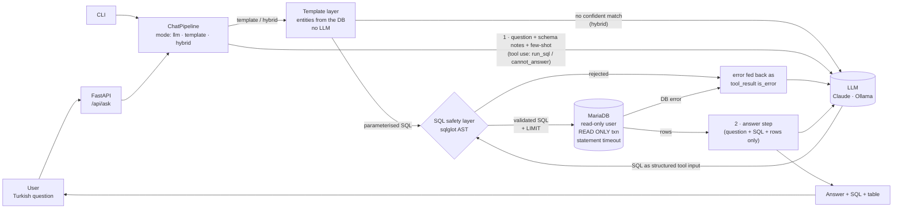

# Seçim Sohbeti — a Turkish text-to-SQL chatbot for 75 years of election data

Ask a question in Turkish, get a short answer with the numbers, **plus the SQL that produced it and the result table**.

> *"2023 ikinci turda Ümraniye'de Kılıçdaroğlu'nun en yüksek oy oranı aldığı 3 mahalle hangileri?"*
> → **Finanskent %73,28, Tatlısu %71,61, Site %69,67.** (and the 3-row table, and the query)

It sits on top of the [Türkiye Seçim Haritası](https://hamikumbasae.github.io/turkiye-secim-haritasi/) database:
46 elections (1950–2024: general, local, presidential, referendums), 81 provinces, ~970 districts, ~46,000
neighbourhoods, **2.8 million vote rows** in MariaDB on a Raspberry Pi.

| Desktop | Mobile (dark) |
|---|---|
|  |  |

More: [landing page with example questions](docs/screenshots/01-baslangic.png) ·
[neighbourhood-level question](docs/screenshots/04-mahalle.png). Screenshots are taken in offline demo mode, see below.

---

## The problem

Election data is perfect for a chatbot and dangerous for one. Users ask in natural Turkish
("Kadıköy'de 2017'de Hayır kaç çıktı?"), the schema has traps (no national row; district names repeat
across provinces — there are 51 "Merkez"; party names changed: HDP → YEŞİL SOL → DEM Parti), and an LLM that
"knows" election results from training data will happily answer from memory instead of the data.

So the design goals were:

1. **Grounded** – every number comes from a query against the database; the answer step only sees the result table.
2. **Transparent** – the SQL and the raw rows are always shown next to the answer.
3. **Safe** – the model writes SQL, so the SQL is treated as untrusted input.
4. **Measured** – a hand-verified gold set and an execution-accuracy eval, not "it looked right in the demo".
5. **Testable without an API key** – the LLM sits behind an interface with a deterministic fake.

## Architecture



| Module | Role |
|---|---|
| `secim_chatbot/prompts.py` | Compact schema, election-code list, **domain notes** (how to compute a national share, how a neighbourhood links to its district, exact party spellings) and 7 few-shot examples. |
| `secim_chatbot/llm.py` | `LLM` protocol · `AnthropicLLM` (official SDK, tool use, prompt caching) · `FakeLLM` (offline) · `make_llm`. |
| `secim_chatbot/ollama.py` | `OllamaLLM`: local models over Ollama's HTTP API, JSON-schema output, defensive parsing. |
| `secim_chatbot/fewshot.py` | Dynamic few-shot for small models: TF-IDF over normalised Turkish with entity placeholders, dev split only. |
| `secim_chatbot/templates.py` | Template layer: slot filling for the top question patterns, parameterised SQL, rule-based refusals. |
| `secim_chatbot/entities.py`, `turkce.py` | Entity lexicon loaded from the DB (snapshot in `data/varliklar.json`), Turkish folding and suffixes. |
| `secim_chatbot/safety.py` | AST-based validation and LIMIT injection. |
| `secim_chatbot/db.py` | Read-only execution: per-query connection, `READ ONLY` transaction, `max_statement_time`. |
| `secim_chatbot/pipeline.py` | Routing (`llm` / `template` / `hybrid`), one retry, fallbacks, timing and token accounting. |
| `secim_chatbot/web/` | FastAPI backend + single-page chat UI (vanilla JS/CSS, no build step). |
| `secim_chatbot/cli.py` | Terminal chat with follow-up questions. |
| `eval/` | Gold set (32 questions), question bank (287), frozen expected results, benchmark runner and comparison table. |

### How the model is called

* **Step 1 – SQL.** The system prompt (~3–4k tokens, cached with `cache_control`) holds the schema and notes.
  The model *must* call one of two tools (`tool_choice: {"type": "any"}`):
  `run_sql {sql, explanation}` or `cannot_answer {reason}`. The SQL therefore arrives as structured JSON, never
  scraped out of prose, and out-of-scope questions ("Yarın hava nasıl?") get an explicit refusal instead of a made-up query.
* **Retry.** If the safety layer rejects the query or MariaDB returns an error, the failed call is replayed to the
  model as a `tool_use` → `tool_result` pair with `is_error: true` and the error text
  (e.g. `[1054] Unknown column 'b.il'`), and the model gets **one** more attempt.
* **Step 2 – answer.** A separate, tool-less call receives only the question, the executed SQL and the result rows
  (as JSON, max 60 rows) and is instructed to use only those numbers, Turkish number format (19.127.097, %35,23).
  If this call fails, a template answer built from the rows is returned — the user still gets the data.
* **Follow-ups.** The last three turns (question + SQL + answer) are sent along, so "peki 2018'de?" works.

## Routing: template, LLM, hybrid

`CHATBOT_MODE` (or `--mode` in the CLI and the benchmark, or the selector in the web UI header) picks the path:

| Mode | What answers | Needs |
|---|---|---|
| `llm` (default) | the language model writes the SQL — Claude, a local model via Ollama, or the offline fake (`LLM_PROVIDER`) | API key or Ollama |
| `template` | only the deterministic template layer; anything it is not sure about gets "no template fits" | the DB |
| `hybrid` | template first; when no template fits — or the template query errors or returns no rows — the LLM | both |

Every response says which path answered (`route`, `answered_by`): the UI shows **şablon** (green) or the model
name next to the latency. Template SQL goes through the same safety layer, read-only user and timeouts as model
SQL; `tests/test_router.py` checks that a buggy template emitting `DELETE` is never executed.

## Template layer

[`secim_chatbot/templates.py`](secim_chatbot/templates.py) implements the most frequent patterns from
[`eval/soru_kaliplari.yaml`](eval/soru_kaliplari.yaml) as parameterised SQL (result of a province/district,
national share, "in how many provinces did X come first", top/bottom N incl. neighbourhoods and thresholds, seats,
turnout, registered voters, differences, closest races, change between two elections, time series, follow-ups),
plus rule-based refusals for what the data does not contain (ballot boxes, MPs' names, demographics, polls,
council votes, invalid votes, pre-1950 …).

**Slots come from the database.** `EntityIndex.from_db()` loads the 46 elections, 81 provinces, every district
name with its plate *per election* (Cizre is Mardin until 1990, Şırnak after), the ballot spellings of parties and
candidates, and the referendum options. Recognition is Turkish-aware: İ/ı and diacritics are folded
("Kadikoy" = "Kadıköy", "ISTANBUL" = "İstanbul"), suffixes are handled with and without the apostrophe
("İzmir'in", "istanbulda", "2023te"), aliases map to ballot names (AKP → AK Parti, Refah Partisi → RP; the
longer "Yeniden Refah" wins), case matters where it must ("İYİ Parti" is a party, "en iyi" is not), and the HDP
line resolves to the name on that election's ballot (HDP 2023 → 'YEŞİL SOL', 2024 → 'DEM Parti').

**Only answer when sure.** A template answers only if every slot is filled unambiguously. It falls through when:
the election is ambiguous ("2015", "2023'te Erdoğan" without the round), a district exists in several provinces
and none is named (Yenişehir, Gölbaşı; 51 × Merkez), a district name is also a common word or region (Genç,
Olur, Akdeniz) without its province, there is an unknown proper noun (a neighbourhood or a mayor's name), or the
question has a negation, an alliance, a yes/no particle, a rank other than first, a threshold/"baraj", a region,
a comparison or a change without two elections. Values in the SQL always come from the lexicon (DB spellings)
or are integers — never the user's text.

### Measured here (template only, local MariaDB, 31 Oct 2026)

`python eval/run_eval.py --set bank --mode template` on the **held-out test split** (216 questions):

| | |
|---|---|
| Overall execution accuracy | **119 / 216 = 55,1 %** |
| Answerable questions answered by a template (SQL) | 95 / 183 = 51,9 % |
| … of those correct | **86 / 95 = 90,5 %** |
| "Veri yok" questions refused correctly | 33 / 33 (12 by an explicit rule, the rest because no template fitted) |
| Answerable questions without a template answer | 88 (in hybrid mode these go to the LLM) |
| Latency p50 / p95 | 8 ms / 22 ms |

Per category (correct / n): cumhurbaşkanlığı 10/12, katılım 8/10, il 12/17, ilçe 10/18, ulusal-toplam 8/14,
yerel 7/14, zaman-serisi 6/10, referandum 5/9, mahalle 5/11, vekil 5/14, fark 4/8, değişim 4/12,
takip-belirsiz 3/10, veri-yok 32/32; bölge 0/6, çapraz 0/6, rekor 0/7, turlar-arası 0/6 (no templates by design).
Full table: [`eval/results/karsilastirma.md`](eval/results/karsilastirma.md).

On the original 32-question gold set: 26 / 32 answered by templates, all 26 correct.

How to read this honestly:

* The templates were written against the **dev split** and the gold set (100 % of what they answered there).
  The *first* run on the test split scored 107 / 216 with 87 / 111 template answers correct (78 %). The wrong
  answers were then read and the general misreads they exposed were fixed — missing synonyms ("artırdı", "bugüne",
  "önündeydi", "yurt içi"), blockers that only matched whole words ("barajını"), a "kaç oy arttı" question
  answered with shares, multi-part questions answered by their first half — and re-ran. So 55,1 % is slightly
  optimistic; the 49,5 % first run is the clean held-out number.
* Of the 9 remaining wrong template answers, 6 are full result lists where the gold SQL hides parties below 1 %
  (`o.oran >= 1`, a convention used only in test items); the template returns all parties. That was left alone
  rather than copying a test-only convention. The other 3 are shape choices (default top-5 for "2023 seçim
  sonuçları", one row vs. two rows for a change, ordering closest races by points vs. votes).
* Template mode's refusal score is trivially high (it refuses whatever it can't parse); the useful numbers are
  coverage and precision. In hybrid mode a wrong template answer is *not* rescued by the LLM, which is why the
  layer is tuned for precision over coverage.

## Local models (Ollama)

`LLM_PROVIDER=ollama` uses a model served by [Ollama](https://ollama.com) on `OLLAMA_HOST`
(default `http://localhost:11434`), implemented in [`secim_chatbot/ollama.py`](secim_chatbot/ollama.py):

* `POST /api/chat`, `stream: false`, with a JSON schema as `format`, so decoding is constrained to
  `{"action": "run_sql" | "cannot_answer", "sql", "explanation", "reason"}`.
* A prompt for small models: compact schema and the eight pitfalls that cause most wrong answers
  (~2,8k characters instead of ~11k for Claude), then the **k most similar solved examples** (`FEWSHOT_K`, default 4)
  as earlier chat turns. Retrieval ([`fewshot.py`](secim_chatbot/fewshot.py)) is TF-IDF over folded Turkish text
  with entities replaced by placeholders, so "Kadıköy'de 2017 Hayır" retrieves "Bornova'da 2010 Evet". The pool is
  the 7 fixed examples plus the **dev** split only; a test asserts no test-split question can appear in the prompt.
* Output is still parsed defensively (code fences, prose around the JSON, a bare SELECT). Output with no usable
  SQL becomes an error that is fed back for the same single retry the Claude path gets; the safety layer is unchanged.
* `num_ctx` is set explicitly (`OLLAMA_NUM_CTX`, default 8192): Ollama's default context silently truncates the prompt.
* Settings: `OLLAMA_MODEL` (default `qwen2.5-coder:7b`), `OLLAMA_TEMPERATURE` (0), `OLLAMA_TIMEOUT` (120 s; the
  first call also loads the model), `OLLAMA_ANSWER=sablon` to skip the second model call and use the deterministic
  answer sentence (faster; the benchmark score does not depend on the sentence).

Tested here against a mock HTTP server only (no GPU in the build container): request shape, structured-output
schema, few-shot from the dev split, malformed output → retry, timeout, model not pulled, server down.
**No accuracy is claimed for any local model yet** — the commands below produce those numbers.

Memory on a 16 GB Mac (Apple silicon, unified memory): `qwen2.5-coder:7b` (≈ 4,7 GB download) runs comfortably
next to normal apps. `qwen2.5-coder:14b` (≈ 9 GB) plus an 8k context needs roughly 10–11 GB: close heavy apps
(browsers with many tabs, Docker, IDEs) before the 14b run, and run the two benchmarks one after the other, not in
parallel. `ollama ps` shows what is loaded; `ollama stop <model>` frees it.

### Benchmark: six configurations, one table

Each run records its summary in `eval/results/karsilastirma.json` (committed) and regenerates
`eval/results/karsilastirma.md`, keeping the latest run per configuration — so the template run made here and
the Ollama/Claude runs made on the Mac end up in one table. Reported: accuracy overall and per category,
answerable-only accuracy, refusal correctness on "veri yok" questions, false refusals, share answered by templates
(and their precision), latency p50/p95, tokens and (Claude only) estimated cost.

```bash
python eval/run_eval.py --set bank --mode template
python eval/run_eval.py --set bank --provider ollama --model qwen2.5-coder:7b
python eval/run_eval.py --set bank --provider ollama --model qwen2.5-coder:14b
python eval/run_eval.py --set bank --provider anthropic                       # needs ANTHROPIC_API_KEY
python eval/run_eval.py --set bank --mode hybrid --provider ollama --model qwen2.5-coder:7b
python eval/run_eval.py --set bank --mode hybrid --provider anthropic
# the same with --set gold for the original 32 questions; rebuild the table only:
python eval/run_eval.py --table
```

`scripts/benchmark.sh` runs all of them (skipping Claude when no key is set).

## Safety design (defence in depth)

The LLM output is treated like user input from the internet. Five independent layers — any one of them alone would
stop a destructive query:

| # | Layer | What it stops |
|---|---|---|
| 1 | **Prompt** – "single SELECT, only these tables" | the common case; cheap but not a security boundary |
| 2 | **AST validation** (`safety.py`, sqlglot, MySQL dialect) | multiple statements, anything but SELECT/UNION/WITH, any write/DDL/`SET`/`INTO OUTFILE`/`FOR UPDATE` node anywhere in the tree, tables outside `secim`, `birim`, `oy` (so no `information_schema`, `mysql.user`, or the large `mahalle` geometry table), `SLEEP`/`BENCHMARK`/`LOAD_FILE`/`USER()`/`VERSION()`…, `@@variables` |
| 3 | **Re-generation + LIMIT** | the executed SQL is regenerated from the AST (comments and anything sqlglot didn't understand are dropped); a `LIMIT 200` is added or clamped on the outer query |
| 4 | **Read-only DB user** (`sql/readonly_user.sql`) | `GRANT SELECT` on the three tables only, `MAX_STATEMENT_TIME 15`, `MAX_USER_CONNECTIONS 10` |
| 5 | **Session limits** (`db.py`) | `START TRANSACTION READ ONLY`, `max_statement_time = 10 s` (MySQL: `max_execution_time`), one short-lived connection per question, rollback after every query |

Plus: question length cap (1000 chars), per-IP rate limit on the web API (20/min), and the UI always shows the SQL.
`tests/test_safety.py` has 47 cases (stacked statements, CTE shadowing a forbidden table, `INTO OUTFILE`, `FOR UPDATE`,
comment smuggling, Turkish literals surviving regeneration, LIMIT/OFFSET handling), and `tests/test_gold.py` checks
that the read-only user really cannot `DELETE` even when the safety layer is bypassed.

## Evaluation

### Gold set
[`eval/gold.yaml`](eval/gold.yaml) contains **32 Turkish questions** written by hand, each with a verified SQL query
and a human-written expected answer. Coverage:

| Category | n | Example |
|---|---|---|
| national totals | 3 | AK Parti's national vote in 2023; HDP June vs Nov 2015 |
| seats (vekil) | 4 | seats per party 2023; ANAP 1983; Trabzon's MPs |
| province | 2 | 1st party in İzmir 2018 |
| district | 4 | Ümraniye 2023 shares; Kadıköy 2017 "Hayır" |
| neighbourhood | 3 | top neighbourhoods in Ümraniye, 2023 2nd round |
| time series | 3 | AK Parti in İstanbul since 2002; Ankara's winner since 1950 |
| referendum | 3 | top "Hayır" provinces 2017; national "Evet" incl. abroad |
| presidential incl. 2nd round | 5 | 2023 2nd round national result; provinces won |
| turnout | 3 | highest / lowest turnout; abroad 2023 |
| local | 2 | provinces CHP won in 2024; flipped AK Parti → CHP 2019→2024 |

All gold queries were executed on the real database; the results are frozen in
[`eval/gold_results.json`](eval/gold_results.json) so data changes are detected (`--freeze` re-creates it).
The 7 few-shot examples in the prompt are deliberately different questions (a test enforces no overlap),
so the eval measures generalisation, not recall.

### Question bank (realistic traffic)
[`eval/soru_bankasi.yaml`](eval/soru_bankasi.yaml) adds **287 questions** modelled on what people actually ask
(news result pages, FAQ boxes, election-analysis pieces; see [docs/RESEARCH.md](docs/RESEARCH.md)): casual
phrasings, follow-ups with `history`, ambiguous questions with a documented default, and 43 questions the data
cannot answer (ballot boxes, MPs' names, demographics, polls, council votes), where the correct behaviour is a
refusal. 244 have verified SQL (results frozen in `eval/soru_bankasi_results.json`); 23 of them are *partial*
and carry the caveat the answer must mention. A `split` field keeps a held-out `test` set (216) apart from a
`dev` pool (71) that few-shot examples may be drawn from — `tests/test_soru_bankasi.py` enforces it.
Ranked question patterns (the source of the template layer): [docs/SORU_KALIPLARI.md](docs/SORU_KALIPLARI.md).

```bash
python eval/run_eval.py --set bank               # held-out test split; refusals count as correct for 'no' items
python eval/run_eval.py --set bank --split all --freeze
```

### Metric: execution accuracy
SQL text is not compared — many different queries are correct. Both the gold SQL and the model's SQL are executed
and the **result sets** are compared (`secim_chatbot/evaluation.py`):

* numbers rounded to 2 decimals, strings compared with Turkish case rules (`İstanbul` = `istanbul`);
* the prediction may have **extra columns** (returning `oy` next to the requested `oran` is fine), but every gold
  column must be matched;
* row count must match; order matters only for top-N/time-series items (`ordered: true`), with ties allowed to swap.

### Running it

```bash
python eval/run_eval.py               # needs ANTHROPIC_API_KEY + DB
python eval/run_eval.py --ids g06,g24 --model claude-opus-5-5
python eval/run_eval.py --fake        # offline smoke test of the runner (FakeLLM knows the gold SQL → 100 %)
```

Output:

```
✓ g01 [ulusal-toplam] <ms>  2023 genel seçiminde AK Parti Türkiye genelinde kaç oy aldı?
✗ g13 [zaman-serisi] <ms>  1950'den bu yana her genel seçimde Ankara'da hangi parti birinci oldu?
    durum=ok  yanıt='...'
...
Doğruluk (execution accuracy): <k>/32 = %<..>
  cumhurbaskanligi   <k>/5
  ...
Reddedilen <n>, başarısız <n>, düzeltmeyle geçen <n>, ort. <ms> ms, token <in> girdi / <out> çıktı, tahmini maliyet $<..>
Ayrıntılı rapor: eval/results/<tarih>-anthropic_claude-sonnet-5-5.json
```

*(Output format only — no API key was available while this was built, so no real-model score is claimed yet.
The `--fake` run above was executed: 32/32, which only proves the runner and matcher work.)*

**How to read the results.** The per-category line shows *where* the model struggles (typically time series and
neighbourhood joins). `düzeltmeyle geçen` counts questions that only succeeded thanks to the retry — a high number
means the prompt is missing a schema detail. Every failure is in the JSON report with the predicted SQL, the gold SQL,
the first rows of both and the model's answer, which is what you read to decide whether to fix the prompt, the
domain notes, or — sometimes — the gold item. A `data_drift` warning means the gold SQL no longer returns the frozen
result (the data changed), not that the model got worse.

## Cost

Per question: one SQL call (~4k input tokens, almost all of it the cached system prompt, ~150 output tokens) and one
short answer call (~0.5–1.5k input, ~100 output). With prompt caching that is well under a cent per question at
Sonnet-class pricing; a full 32-question eval run costs a few cents. The eval prints the exact token counts; the
dollar estimate uses `--price-in/--price-out` (USD per million tokens) — set them to the
[current price list](https://www.anthropic.com/pricing). The web API has a per-IP rate limit so a public demo
cannot run up a bill.

## Running it

### Demo mode (no API key)
`LLM_PROVIDER=fake` (or simply no `ANTHROPIC_API_KEY`) swaps in `FakeLLM`: it answers the gold-set / example questions
with their verified SQL — the query still goes through the safety layer and the real database — and politely refuses
anything else. The UI shows a "demo modu" badge. This is what the screenshots and the UI end-to-end test use.

### Tests

```bash
cd chatbot
python -m pytest                       # 854 tests; DB-backed ones skip automatically without a database
python scripts/screenshots.py          # UI end-to-end in Chromium (server must be running in demo mode)
```

* `test_safety.py` – allowed/rejected queries, LIMIT handling, comment stripping
* `test_ollama.py` – Ollama provider against a mock HTTP server: request shape, JSON-schema output, dev-only few-shot, malformed output → retry, timeout, missing model, server down
* `test_entities.py` – Turkish folding/suffixes, aliases, case-sensitive names, duplicate and moved districts, snapshot = DB
* `test_templates.py` – election resolution, fall-through cases, rule refusals, every template through the safety layer, and (with a DB) each template against frozen known answers from the dev split and the gold set
* `test_router.py` – modes, fall-through on no match / DB error / empty result, unsafe template SQL never executed, per-request mode in the API, benchmark summary and table
* `test_pipeline.py` – happy path, unsafe SQL never executed, retry with DB error, give-up, refusal, LLM/network failure, history, token accounting (FakeLLM + in-memory DB)
* `test_anthropic_adapter.py` – the exact request sent to the SDK (tools, `tool_choice`, cache control, `is_error` tool results) against a stub client
* `test_api.py` – FastAPI endpoints, validation, rate limit
* `test_evaluation.py` – the result-set matcher
* `test_gold.py` – gold set shape and coverage, every gold SQL passes the safety layer, no few-shot leakage, and (with a DB) gold results still match the snapshot, few-shot SQL runs, the read-only user cannot write

---

## Hızlı başlangıç (Mac, Raspberry Pi'deki veritabanı)

Pi'de MariaDB `192.168.1.2` adresinde, `secim` veritabanı yüklü olmalı. Komutlar repo kökünden.

**1. Salt-okunur kullanıcıyı Pi'de bir kez oluştur** (şifreyi dosyada değiştir):

```bash
nano chatbot/sql/readonly_user.sql          # 'degistir-beni' yerine kendi şifren
mysql -h 192.168.1.2 -u root -p < chatbot/sql/readonly_user.sql
```

> Pi'deki MariaDB ağdan bağlantı kabul etmiyorsa `/etc/mysql/mariadb.conf.d/50-server.cnf` içinde
> `bind-address = 0.0.0.0` olmalı. Geçici olarak `DB_USER=hami` ile de çalışır, ama salt-okunur kullanıcı önerilir.

**2. Kurulum:**

```bash
cd chatbot
python3 -m venv .venv
source .venv/bin/activate
pip install -r requirements.txt
```

**3. Anahtar ve şifre:**

```bash
export ANTHROPIC_API_KEY='sk-ant-...'
export DB_PASSWORD='salt-okunur-kullanicinin-sifresi'
export DB_HOST=192.168.1.2 DB_USER=secim_okur
# isteğe bağlı: export ANTHROPIC_MODEL=claude-sonnet-5-5
```

(Ya da `cp .env.example .env` yapıp değerleri oraya yaz; `.env` git'e girmez.)

**4. Web arayüzü:**

```bash
uvicorn secim_chatbot.web.app:app --port 8000
open http://127.0.0.1:8000
```

**5. Terminal:**

```bash
python -m secim_chatbot.cli                                        # etkileşimli, takip soruları çalışır
python -m secim_chatbot.cli "2018'de Bursa'dan hangi parti kaç vekil çıkardı?"
```

**6. Değerlendirme (doğruluk ölçümü):**

```bash
python eval/run_eval.py
```

**Anahtarsız deneme:** `LLM_PROVIDER=fake uvicorn secim_chatbot.web.app:app --port 8000` — yalnız örnek sorular
yanıtlanır, sorgular yine gerçek veritabanında çalışır. Testler: `python -m pytest`.

**Modelsiz (yalnız şablon) ya da karma:** `CHATBOT_MODE=template` hiçbir dil modeli kullanmaz;
`CHATBOT_MODE=hybrid` önce şablonu dener, uymazsa modele gider. Web arayüzünde sağ üstteki seçiciyle de değişir;
her yanıtın altında "şablon" ya da model adı ve süre yazar.

---

## Mac'te yerel model (Ollama) — hızlı başlangıç

MacBook Pro M4, 16 GB için. Yukarıdaki 1–3. adımlar (sanal ortam, veritabanı değişkenleri) yapılmış olmalı.

**1. Ollama'yı kur ve modelleri indir:**

```bash
brew install ollama            # ya da https://ollama.com/download adresinden Mac uygulaması
ollama serve                   # uygulamayı kurduysan gerekmez (arka planda çalışır); brew ile kurduysan ayrı bir terminalde
ollama pull qwen2.5-coder:7b   # ≈ 4,7 GB
ollama pull qwen2.5-coder:14b  # ≈ 9 GB
ollama list                    # ikisi de görünmeli
```

**2. Sohbet botunu yerel modelle çalıştır:**

```bash
cd chatbot && source .venv/bin/activate
export DB_HOST=192.168.1.2 DB_USER=secim_okur DB_PASSWORD='...'
export LLM_PROVIDER=ollama OLLAMA_MODEL=qwen2.5-coder:7b
python -m secim_chatbot.cli "2018'de Bursa'dan hangi parti kaç vekil çıkardı?"
CHATBOT_MODE=hybrid uvicorn secim_chatbot.web.app:app --port 8000      # önce şablon, sonra yerel model
```

**3. Karşılaştırma ölçümü (soru bankasının test bölümü, 216 soru):**

```bash
python eval/run_eval.py --set bank --mode template
python eval/run_eval.py --set bank --provider ollama --model qwen2.5-coder:7b
python eval/run_eval.py --set bank --provider ollama --model qwen2.5-coder:14b
python eval/run_eval.py --set bank --mode hybrid --provider ollama --model qwen2.5-coder:7b
export ANTHROPIC_API_KEY='sk-ant-...'                                  # Claude satırları için
python eval/run_eval.py --set bank --provider anthropic
python eval/run_eval.py --set bank --mode hybrid --provider anthropic
python eval/run_eval.py --table                                         # tabloyu yeniden üret
open eval/results/karsilastirma.md
```

Hepsini tek seferde: `bash scripts/benchmark.sh` (anahtar yoksa Claude satırlarını atlar; `--set gold` dahil).
Aynı komutlar `--set gold` ile orijinal 32 soruda da çalışır. Her çalıştırma `karsilastirma.json`'a kaydedilir,
tablo tüm çalıştırmaları birleştirir; sonuçları commit'leyip gönderebilirsin.

**Bellek (16 GB):** 7b rahat çalışır. 14b + 8k bağlam ≈ 10–11 GB ister: 14b ölçümünden önce Chrome/Safari'deki
çok sekmeyi, Docker'ı, Xcode/IDE gibi ağır uygulamaları kapat; ölçümleri art arda çalıştır, aynı anda değil.
`ollama ps` yüklü modeli gösterir, `ollama stop qwen2.5-coder:14b` belleği boşaltır. Takılırsa
`OLLAMA_NUM_CTX=6144` ile bağlamı küçült. İlk soru modeli yüklediği için yavaştır (p95'e yansır); ölçümden önce
bir kez `ollama run qwen2.5-coder:7b "merhaba"` ile ısıtabilirsin. Süre için yanıt cümlesini de modele yazdırmak
istemezsen `OLLAMA_ANSWER=sablon` (doğruluk puanını etkilemez).
