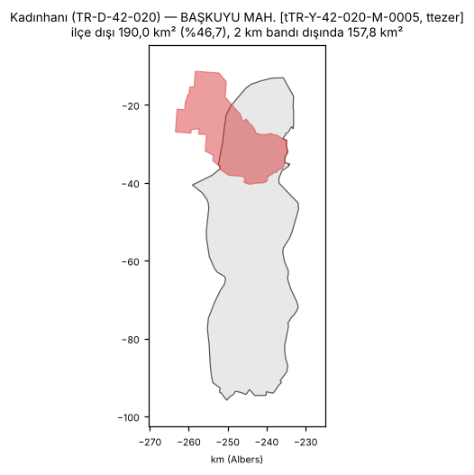
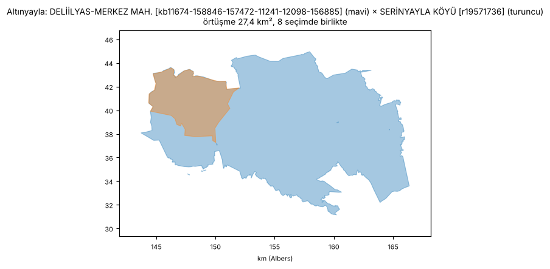
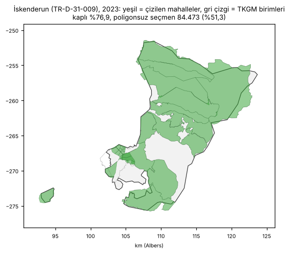
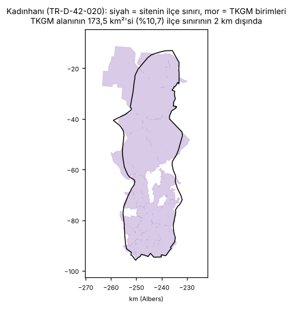

# Geometri denetimi — il, ilçe ve mahalle sınırları

Bu rapor `scripts/rapor/geometri_denetimi.py` ile üretildi; aynı veriyle her çalıştırmada aynı sonucu verir. Hiçbir geometri ya da veri dosyası değiştirilmedi. Bütün satırlar `docs/rapor/geometri_denetimi/` altındaki CSV'lerdedir.

Yeniden üretmek için (shapely ve pyproj gerekir, ~5 dakika):

```bash
python3 scripts/rapor/geometri_denetimi.py
```

## 1. Kısa özet

Haritada 973 bugünkü ilçe, 81 il, 919 tarihsel ilçe ve 990 ilçe kimliğine bağlı 49.332 mahalle poligonu var. Sonuç:

**Gerçek sorunlar (düzeltilmesi gerekenler)**

1. **Yanlış yere çizilen mahalleler.** 9 mahalle poligonu kendi ilçesinin 2 km'den daha dışında duruyor; 9'i en az bir seçimde çiziliyor. En uzak örnekler: Çukurca CEVİZLİ KÖYÜ → Merkez (3,7 km), Elmalı YUVA MAH. → Seydikemer (3,1 km), Bayat BAYAN KÖYÜ → Merkez (3,0 km). Bu mahallelerin oyu yanlış yerde boyanıyor ve ilçe haritası gereksiz yere uzaklaşıyor (bölüm 4.2).
2. **Üst üste çizilen TKGM birimleri.** Aynı seçimde birlikte çizilen ve anlamlı ölçüde (≥ 1 ha ve küçüğün ≥ %1'i) örtüşen 1.742 mahalle çifti var (793 km²). Bunların 10'i (41 km²) TKGM × TKGM. TKGM ham verisi kendi içinde örtüşüyor (21.366 çift, 52.638 km²) ve eşleştirme betiğinin %25 kuralı yalnız TKGM ile TKGM dışı sınırlar arasında uygulanıyor. Örtüşen iki poligondan biri ötekini örtüyor; alttaki mahallenin rengi görünmüyor, tıklanamıyor. 1 çiftte iki muhtarlık neredeyse aynı poligona düşmüş (bölüm 4.3).
3. **Haritaya bağlanmayan seçmen.** 2023 genel seçimde mahalle sonuçlarındaki seçmenin %94,63'i bir poligona bağlı; eksik kalan seçmen birkaç ilde toplanıyor (Hatay, Kahramanmaraş, Elazığ, Aksaray). Rakamlar belgelerdekinden biraz yüksek: sonraki eşleştirme düzeltmeleri kapsamı artırmış (bölüm 4.6).

**Küçük, görünümü az etkileyen sorunlar**

4. 31 mahalle, 0 ilçe, 0 il ve 7 tarihsel ilçe poligonu geometrik olarak geçersiz (çoğu kendi kendini kesen halka). Tarayıcı bunları çiziyor; alan ve kesişim hesaplarını bozuyor.
5. 1 mahalle poligonunda delik, dış halkayla aynı yönde yazılmış. Site SVG'yi varsayılan `nonzero` kuralıyla dolduruyor; bu deliklerin içi dolu çiziliyor. 0 kayıt poligon değil, çizgi (LineString); 0 kaydın alanı sıfır.
6. İlçe katmanı: ilçe başına ortalama 175 nokta. Komşu ilçeler arasında 1 dikiş boşluğu (0 km²) ve 13 örtüşme (0,1 km²) var; haritada kıl inceliğinde çizgiler olarak görünür.
7. 15 mahalle poligonu hiçbir seçimde çizilmiyor (0,0 MB ham GeoJSON).

**Sorun olmayanlar**

- Mahalle poligonlarının ilçe sınırından taşan alanı 24.885 km² (%3,3). Bunun çoğu sınırdaki çizim farkı (kaynaklar sınırı farklı ayrıntıda çiziyor): ilçe sınırına 2 km'lik pay verilince taşma 2.887 km²'ye (%0,4) iniyor.
- Eşleştirme betiğinin "mevcut poligonlarla %25'ten fazla örtüşen TKGM birimi çizilmez" kuralı tutuyor: 0 ihlal.
- Belediye × ttezer, Belediye × OSM gibi büyük örtüşmeler aynı seçimde birlikte çizilmiyor (eski kaynak başka seçimde kullanılıyor); haritada görünmüyor.
- Tarihsel ilçelerin 856'ü bugünkü parçalarının birleşimiyle birebir aynı. Depodaki iki geometri testi (`tests/validate_elections.py`: tarihsel ilçe örtüşme/delik ve seçim ilçe eşleme tabloları) shapely kurulunca çalıştı ve geçti.
- Dönem il sınırları (era*) geçerli; toplam alanları bugünkü ülkeyle %0,02 içinde aynı (iller arası küçük kenar örtüşmeleri var, bkz. 4.5).
- Verisi olup poligonu olmayan mahalle kaydı yok (site, sonucu olan her kaydın poligonunu buluyor).

## 2. Ne kontrol edildi, nasıl

Alanlar eşit alanlı Albers izdüşümünde (standart paraleller 37° ve 41° K, merkez 39° K / 35° D) hesaplandı. Geçersiz poligonlar hesap için `make_valid` ile onarıldı; dosyalar değişmedi.

Mahalle anahtarının ilk harfi kaynağı gösterir (`scripts/pipelines/mahalle_veri`):

| Önek | Kaynak | Poligon |
|---|---|---|
| `t…` | ttezer/turkiye-harita-verisi (25 ilde belediye/MAKS) | 15.145 |
| `r…` | OpenStreetMap | 5.891 |
| `b…` | Belediye açık verisi (Bursa, Sakarya) | 1.729 |
| `k…`, `kb…` | TKGM kadastro mahallesi (`kb`: bölümlü birimlerin birleşimi, 94) | 26.567 |

**Sınır bandı.** İlçe sınırı ile mahalle kaynakları (TKGM, belediye, OSM) sınırı farklı ayrıntıda ve kaynakta çiziyor (`geo/normalized/PROVENANCE.md`); iki çizgi 1–2 km ayrılabiliyor. Mahalle poligonları bu yüzden kenarda ilçe dışına taşıyor. Gerçek hatayı gürültüden ayırmak için ilçe sınırına 2 km pay verilmiş hâli de ölçüldü ("2 km bandı dışında").

**Birlikte çizilme.** Site bir seçimde yalnız o seçimin verisi olan mahalle poligonlarını çizer. İki poligon hiçbir seçimde birlikte çizilmiyorsa örtüşmeleri haritada görünmez; bu yüzden her örtüşme için ortak seçim sayısı hesaplandı.

| # | Kontrol | CSV |
|---|---|---|
| 1 | Geçersiz, boş, kıymık, kırıntı parça, birebir aynı geometri, halka yönü | `gecersiz_geometri.csv`, `kiymik_kucuk.csv`, `yinelenen_geometri.csv` |
| 2 | Mahallenin ilçe dışında kalan payı (> %5 ve > 1 km²), yanlış ilçe (temsil noktası) | `mahalle_ilce_disi.csv`, `mahalle_yanlis_ilce.csv` |
| 3 | Aynı ilçede mahalle–mahalle örtüşmesi, kaynak çifti, birlikte çizilme; TKGM %25 kuralı | `mahalle_ortusme.csv`, `tkgm_yuzde25_kurali.csv` |
| 4 | İlçe alanının mahallelerce kaplanmayan payı; TKGM birimi olan/olmayan boşluk; poligonsuz seçmen | `ilce_bosluk.csv` |
| 5 | İlçe örtüşmesi ve dikiş boşlukları, il ↔ ilçeler, dönem il sınırları, tarihsel ilçeler | `ilce_ortusme.csv`, `ilce_katmani_delikler.csv`, `il_ilce_tutarlilik.csv`, `donem_il_sinirlari.csv`, `tarihsel_ilce_birlesim.csv` |
| 6 | Seçim başına poligonu olan seçmen (ülke, il) | `kapsam_secmen_ozet.csv`, `kapsam_secmen_il.csv` |
| 7 | İlçe sınırı ↔ TKGM ham birimlerinin ilçe birleşimi (bağımsız kaynak) | `tkgm_ilce_karsilastirma.csv` |

## 3. Envanter

| Katman | Kayıt | Geçersiz | Diğer bulgular |
|---|---|---|---|
| il | 81 | 0 | kırıntı parçalı: 4 |
| ilçe | 973 | 0 | kırıntı parçalı: 9 |
| tarihsel ilçe | 919 | 7 | kırıntı parçalı: 9 |
| mahalle | 49.332 | 31 | delik dış halkayla aynı yönde (SVG'de dolu çizilir): 1; kırıntı parçalı: 367; kıymık (çok ince): 1; çok küçük (< 500 m²): 6 |
| il era1950 | 63 | 0 | kırıntı parçalı: 4 |
| il era1954 | 64 | 0 | kırıntı parçalı: 4 |
| il era1955 | 66 | 0 | kırıntı parçalı: 4 |
| il era1957_1965 | 67 | 0 | kırıntı parçalı: 4 |
| il era1957_1987 | 67 | 0 | kırıntı parçalı: 4 |
| il era1991 | 74 | 0 | kırıntı parçalı: 4 |
| il era1994 | 76 | 0 | kırıntı parçalı: 4 |
| il era1995 | 79 | 0 | kırıntı parçalı: 4 |
| il era1999 | 80 | 0 | kırıntı parçalı: 4 |

Hiçbir seçimde çizilmeyen mahalle poligonu: 15 (TKGM 15).

## 4. Bulgular

### 4.1 Geçerlilik

| Mahalle poligonunda sorun | Sayı |
|---|---|
| geçersiz: Self-intersection | 31 |
| delik dış halkayla aynı yönde (SVG'de dolu çizilir) | 1 |

Kendi kendini kesen halkalar büyük olasılıkla kaynakların sadeleştirilmesinden ve 4 ondalığa yuvarlanmasından (TKGM: 10 m Douglas-Peucker) çıkan küçük düğümlerdir; tarayıcı bunları çizer. "Too few points" bir parçanın 4'ten az noktaya düşmesidir; o parça çizilmez.

**Deliği dolu çizilen poligonlar** (1; ilk 20, alana göre). Site `fill-rule` belirtmiyor (SVG varsayılanı `nonzero`); delik dış halkayla aynı yönde yazılınca içi mahallenin rengiyle boyanır. Delikteki komşu mahalle sonra çizilirse görünür, önce çizilirse altta kalır.

| İlçe | Anahtar | Mahalle | Alan km² |
|---|---|---|---|
| TR-D-45-004 | `kb151313-149118` | DURHASAN MAH. | 27,4 |

**Birebir aynı geometri.** Mahallede 1641 grup tarihsel ilçeye (HIST-) kopyalanmış halef poligonu; beklenen. Kalan gruplarda iki ayrı muhtarlık aynı poligonu paylaşıyor (TKGM'de aynı sınırla iki birim):

| İlçe | Poligonlar | Tür |
|---|---|---|

Kıymık ve çok küçük poligonlar önemsiz: 1 kıymık, 6 çok küçük, 367 poligonda 1.000 m²'den küçük kırıntı parça (`kiymik_kucuk.csv`).

Dış halka yönü kaynaktan kaynağa değişiyor (mahallede saat yönü: 18.218, saat yönü tersi: 33.334). Site kendi düzlem izdüşümünü kullandığı için dış halka yönü sorun değil; yalnız delik yönü önemli.

### 4.2 Mahalle ile ilçesi

| Ölçü | Değer |
|---|---|
| İlçe dışına taşan toplam mahalle alanı | 24.885 km² (%3,32) |
| … 2 km sınır bandı dışında kalan | 2.887 km² (%0,39) |
| > %5 ve > 1 km² taşan mahalle | 3.863 (çizilen 3.863); Belediye 93, OSM 77, TKGM 2.878, ttezer 815 |
| … 2 km bandı dışında da > %5 ve > 1 km² | 284 (çizilen 284); Belediye 6, OSM 12, TKGM 206, ttezer 60 |
| Temsil noktası kendi ilçesinde olmayan | 199 (çizilen 199; denizde 5) |
| … kendi ilçesinden 2 km'den uzak | 9 (çizilen 9); TKGM 5, ttezer 4 |

Taşmaların çoğu sınır gürültüsü. Kalan büyük taşmalarda mahalle poligonu ile TKGM çoğu kez aynı yerde, sitenin ilçe sınırı farklı (Kadınhanı'nda ttezer "Başkuyu" ile TKGM "Başkuyu-Fatih" aynı 406 km²'yi kaplıyor ve ikisi de ilçe sınırının %47 dışında). Bu durumlarda hatalı olan büyük olasılıkla ilçe katmanıdır (bkz. 4.7).

**Kendi ilçesinden 2 km'den uzakta duran mahalleler** (ilk 20, uzaklığa göre; tamamı `mahalle_yanlis_ilce.csv`):

| İlçe (geomId) | Anahtar | Mahalle | Kaynak | Bulunduğu ilçe | Uzaklık km | Alan km² | Çizildiği seçim |
|---|---|---|---|---|---|---|---|
| Çukurca (TR-D-30-001) | `k29588` | CEVİZLİ KÖYÜ | TKGM | Merkez (TR-D-30-002) | 3,7 | 122,22 | 7 |
| Elmalı (TR-D-07-006) | `tTR-Y-07-006-M-0059` | YUVA MAH. | ttezer | Seydikemer (TR-D-48-011) | 3,1 | 111,92 | 12 |
| Bayat (TR-D-19-002) | `k161277` | BAYAN KÖYÜ | TKGM | Merkez (TR-D-18-003) | 3,0 | 13,18 | 11 |
| Finike (TR-D-07-007) | `tTR-Y-07-007-M-0001` | AKÇAALAN MAH. | ttezer | Kumluca (TR-D-07-016) | 2,8 | 39,81 | 14 |
| Murgul (TR-D-08-007) | `k42456` | PETEK KÖYÜ | TKGM | Arhavi (TR-D-08-002) | 2,6 | 101,37 | 11 |
| Kadınhanı (TR-D-42-020) | `k146997` | BAŞKUYU-FATİH MAH. | TKGM | Yunak (TR-D-42-031) | 2,5 | 406,31 | 3 |
| Kadınhanı (TR-D-42-020) | `tTR-Y-42-020-M-0005` | BAŞKUYU MAH. | ttezer | Yunak (TR-D-42-031) | 2,5 | 406,71 | 12 |
| Alanya (TR-D-07-003) | `tTR-Y-07-003-M-0024` | CİKCİLLİ MAH. | ttezer | Hadim (TR-D-42-016) | 2,2 | 24,26 | 12 |
| Merkez (TR-D-43-009) | `k143215` | İSHAKÇILAR KÖYÜ | TKGM | Tavşanlı (TR-D-43-013) | 2,0 | 16,45 | 11 |

**İlçesinin 2 km bandı dışına en çok taşan çizilen mahalleler** (ilk 20; tamamı `mahalle_ilce_disi.csv`):

| İlçe (geomId) | Anahtar | Mahalle | Kaynak | Alan km² | İlçe dışı km² (%) | 2 km bandı dışı km² (%) | Seçim |
|---|---|---|---|---|---|---|---|
| Kadınhanı (TR-D-42-020) | `tTR-Y-42-020-M-0005` | BAŞKUYU MAH. | ttezer | 406,7 | 190,0 (%46,7) | 157,8 (%38,8) | 12 |
| Kadınhanı (TR-D-42-020) | `k146997` | BAŞKUYU-FATİH MAH. | TKGM | 406,3 | 189,8 (%46,7) | 157,6 (%38,8) | 3 |
| Toroslar (TR-D-33-012) | `k127415` | ARSLANKÖY MAH. | TKGM | 390,0 | 171,6 (%44,0) | 110,1 (%28,2) | 15 |
| Elmalı (TR-D-07-006) | `tTR-Y-07-006-M-0059` | YUVA MAH. | ttezer | 111,9 | 88,9 (%79,4) | 64,5 (%57,7) | 12 |
| Çukurca (TR-D-30-001) | `k29588` | CEVİZLİ KÖYÜ | TKGM | 122,2 | 72,2 (%59,0) | 64,4 (%52,7) | 7 |
| Ovacık (TR-D-62-005) | `k49353` | EĞRİPINAR KÖYÜ | TKGM | 105,2 | 66,4 (%63,1) | 43,2 (%41,1) | 11 |
| Kulp (TR-D-21-013) | `k35350` | ALACA MAH. | TKGM | 198,8 | 72,3 (%36,4) | 37,6 (%18,9) | 14 |
| Murgul (TR-D-08-007) | `k42456` | PETEK KÖYÜ | TKGM | 101,4 | 62,5 (%61,6) | 30,8 (%30,4) | 11 |
| Elbistan (TR-D-46-006) | `k169360` | KARAHASANUŞAĞI MAH. | TKGM | 101,8 | 44,1 (%43,3) | 29,8 (%29,3) | 14 |
| Ereğli (TR-D-42-014) | `tTR-Y-42-014-M-0017` | BELKAYA MAH. | ttezer | 196,0 | 47,1 (%24,0) | 29,3 (%15,0) | 12 |
| Elmalı (TR-D-07-006) | `tTR-Y-07-006-M-0055` | YAPRAKLI MAH. | ttezer | 78,8 | 59,0 (%74,9) | 29,1 (%37,0) | 14 |
| Bala (TR-D-06-004) | `tTR-Y-06-004-M-SRC-KUYULAR` | KUYULAR MAH. | ttezer | 97,6 | 38,0 (%38,9) | 25,9 (%26,5) | 12 |
| Afşin (TR-D-46-001) | `k168351` | ARITAŞ MAH. | TKGM | 209,9 | 63,6 (%30,3) | 24,6 (%11,7) | 12 |
| Elmalı (TR-D-07-006) | `k137797` | BÜYÜKSÖYLE KÖYÜ | TKGM | 159,2 | 46,2 (%29,0) | 23,9 (%15,0) | 2 |
| Eruh (TR-D-56-002) | `k168204` | OKÇULAR KÖYÜ | TKGM | 95,3 | 52,1 (%54,7) | 23,8 (%24,9) | 8 |
| İskenderun (HISTK-31-009-4e2712) | `k128992` | KARAGÖZ KÖYÜ | TKGM | 59,7 | 41,0 (%68,6) | 23,1 (%38,8) | 2 |
| Arsuz (TR-D-31-003) | `k128992` | KARAGÖZ MAH. | TKGM | 59,7 | 41,0 (%68,6) | 23,1 (%38,8) | 12 |
| Elmalı (TR-D-07-006) | `tTR-Y-07-006-M-0010` | BÜYÜKSÖĞLE MAH. | ttezer | 158,9 | 44,9 (%28,2) | 23,0 (%14,5) | 12 |
| Merkez (TR-D-75-001) | `k129952` | BAĞDAŞAN KÖYÜ | TKGM | 71,9 | 46,6 (%64,8) | 22,9 (%31,9) | 11 |
| Kırkağaç (TR-D-45-007) | `k151706` | ÇİFTLİK MAH. | TKGM | 87,8 | 46,9 (%53,4) | 22,3 (%25,4) | 14 |

### 4.3 Mahalle–mahalle örtüşmesi

Aynı ilçe içinde 1.000 m²'den büyük 33.096 örtüşen çift var. "Anlamlı": ≥ 1 ha ve küçük poligonun ≥ %1'i. "Birlikte çizilen": iki poligon en az bir seçimde aynı haritada.

| Kaynak çifti | Çift | Alan km² | Anlamlı | Anlamlı km² | Birlikte çizilen | Birlikte km² |
|---|---|---|---|---|---|---|
| OSM × TKGM | 2.608 | 2.094,7 | 1.126 | 2.043,9 | 969 | 462,0 |
| TKGM × ttezer | 2.767 | 10.577,0 | 952 | 10.517,7 | 405 | 224,4 |
| TKGM × TKGM | 24.274 | 3.320,6 | 187 | 2.958,1 | 10 | 41,1 |
| OSM × ttezer | 1.538 | 2.362,1 | 301 | 2.333,4 | 199 | 32,1 |
| OSM × OSM | 387 | 29,3 | 106 | 24,5 | 106 | 24,5 |
| Belediye × TKGM | 64 | 211,3 | 35 | 210,6 | 10 | 5,3 |
| ttezer × ttezer | 800 | 17,7 | 40 | 2,7 | 40 | 2,7 |
| Belediye × ttezer | 11 | 41,2 | 5 | 41,1 | 3 | 1,1 |
| Belediye × Belediye | 642 | 1,5 | 0 | 0,0 | 0 | 0,0 |
| Belediye × OSM | 5 | 3,3 | 1 | 3,2 | 0 | 0,0 |

- **TKGM %25 kuralı tutuyor:** her seçimde, çizilen her TKGM birimi için o seçimde çizilen TKGM dışı poligonlarla örtüşme hesaplandı; %25'i aşan 0 kayıt var (`tkgm_yuzde25_kurali.csv`). OSM × TKGM ve TKGM × ttezer birlikte çizilen örtüşmeleri bu yüzden %25'in altında kalan kenar örtüşmeleridir.
- **TKGM × TKGM için kural yok.** TKGM'nin kendi birimleri iç içe ya da üst üste olabiliyor (ham veride aynı ilçe içinde 21.366 anlamlı çift, 52.638 km²): belde mahallesi ile onu içeren köy birimi, aynı sınırla iki ayrı köy gibi. Eşleştirme iki muhtarlığı bu iki birime ayrı ayrı bağlayınca ikisi de çiziliyor.
- Neredeyse aynı (IoU ≥ 0,95) 188 çift var; 1'ü birlikte çiziliyor.

**Birlikte çizilen en büyük örtüşmeler** (ilk 20; tamamı `mahalle_ortusme.csv`):

| İlçe (geomId) | Mahalle 1 | Mahalle 2 | Kaynak | Örtüşme km² | Küçüğün % | Ortak seçim |
|---|---|---|---|---|---|---|
| Altınyayla (TR-D-58-002) | DELİİLYAS-MERKEZ MAH. (`kb11674-158846-157472-11241-12098-156885`) | SERİNYAYLA KÖYÜ (`r19571736`) | OSM × TKGM | 27,39 | 99,5 | 8 |
| Dalaman (TR-D-48-002) | KAPUKARGIN MAH. (`k166623`) | EGE MAH. (`tTR-Y-48-002-M-0008`) | TKGM × ttezer | 21,13 | 62,4 | 14 |
| Melikgazi (TR-D-38-008) | KIRANARDI FATİH MAH. (`r3458440`) | KIRANARDI MAH. (`r7779478`) | OSM × OSM | 17,31 | 100,0 | 10 |
| Altınyayla (TR-D-58-002) | DELİİLYAS-MERKEZ MAH. (`kb11674-158846-157472-11241-12098-156885`) | YASSIPINAR KÖYÜ (`r19571737`) | OSM × TKGM | 15,58 | 91,6 | 2 |
| Merkez (TR-D-49-005) | KARAAĞAÇLI-BAĞLAR MAH. (`k206354`) | KARAAĞAÇ KÖYÜ (`kb206354-206355-206356`) | TKGM × TKGM | 15,03 | 100,0 | 3 |
| Merkez (TR-D-49-005) | KARAAĞAÇLI-KÜLTÜR MAH. (`k206356`) | KARAAĞAÇ KÖYÜ (`kb206354-206355-206356`) | TKGM × TKGM | 13,03 | 100,0 | 3 |
| Merkez (TR-D-49-005) | KARAAĞAÇLI-ÇUBUKLU MAH. (`k206355`) | KARAAĞAÇ KÖYÜ (`kb206354-206355-206356`) | TKGM × TKGM | 12,52 | 100,0 | 3 |
| Çumra (TR-D-42-009) | GÜVERCİNLİK-MERKEZ MAH. (`k146713`) | YENİ MAH. (`r9233406`) | OSM × TKGM | 7,27 | 43,0 | 3 |
| Tatvan (TR-D-13-007) | BENEKLİ KÖYÜ (`k158811`) | KARŞIYAKA MAH. (`r12321177`) | OSM × TKGM | 7,14 | 36,1 | 11 |
| Ayrancı (TR-D-70-001) | DİVLE KÖYÜ (`k52134`) | AĞIZBOĞAZ KÖYÜ (`r13401694`) | OSM × TKGM | 6,72 | 5,7 | 11 |
| Doğanşehir (TR-D-44-006) | KURUCAOVA-MERKEZ MAH. (`k159272`) | ESKİKÖY MAH. (`r13726944`) | OSM × TKGM | 6,18 | 5,6 | 2 |
| Beylikdüzü (TR-D-34-012) | YAKUPLU MERKEZ MAH. (`r9293239`) | YAKUPLU MAH. (`tTR-Y-34-012-M-0010`) | OSM × ttezer | 5,98 | 98,5 | 1 |
| Ayaş (TR-D-06-003) | OLTAN-KARAHASAN MAH. (`k203995`) | SİNANLI CUMA MAH. (`tTR-Y-06-003-M-0027`) | TKGM × ttezer | 5,36 | 5,6 | 3 |
| Tavas (TR-D-20-019) | SARABAT MAH. (`k166467`) | TEKKEKÖY MAH. (`tTR-Y-20-019-M-0042`) | TKGM × ttezer | 5,17 | 26,2 | 14 |
| Tatvan (TR-D-13-007) | KIYIDÜZÜ KÖYÜ (`k153178`) | CUMHURİYET MAH. (`r12321138`) | OSM × TKGM | 5,08 | 57,1 | 11 |
| Tavas (TR-D-20-019) | BAHARLAR-MERKEZ MAH. (`k166440`) | KEÇELİLER MAH. (`tTR-Y-20-019-M-0027`) | TKGM × ttezer | 4,86 | 91,1 | 2 |
| İskenderun (HISTK-31-009-4e2712) | KARAHÜSEYİNLİ KÖYÜ (`k129007`) | ARPADERESİ MAH. (`r20333375`) | OSM × TKGM | 4,83 | 58,7 | 2 |
| Arsuz (TR-D-31-003) | KARAHÜSEYİNLİ MAH. (`k129007`) | ARPADERESİ MAH. (`r20333375`) | OSM × TKGM | 4,83 | 58,7 | 12 |
| Merkez (TR-D-58-012) | YAZIBAŞI KÖYÜ (`k126118`) | DANİŞMENTGAZİ MAH. (`tTR-Y-58-012-M-0013`) | TKGM × ttezer | 4,82 | 17,9 | 11 |
| Alanya (TR-D-07-003) | AVSALLAR-MERKEZ MAH. (`k137618`) | ÇAKALLAR MAH. (`tTR-Y-07-003-M-0021`) | TKGM × ttezer | 4,75 | 31,3 | 2 |

### 4.4 Boşluklar: ilçenin mahallelerce kaplanmayan alanı

"TKGM birimli boşluk": boş kalan alanda TKGM ham verisinde bir birim var (eşleşmeyen ya da çakışma yüzünden çizilmeyen muhtarlık, ya da muhtarlığı olmayan birim). "Birimsiz boşluk": TKGM'de de birim yok (orman, göl, hazine/askerî alan ya da TKGM'nin sınırını vermediği 2.768 birim). Boşluk seçmen kaybı demek değildir; kayıp "poligonsuz seçmen" sütunundadır.

| Seçim | İlçe | Kaplı alan | Boşluk km² | TKGM birimli km² | Hiç poligonu olmayan ilçe | Dağılım (ilçe sayısı) |
|---|---|---|---|---|---|---|
| bütün poligonlar | 990 | %87,2 | 103.467 | 31.695 | 0 | <%25: 4, %25–50: 20, %50–75: 105, %75–90: 260, %90–99: 488, ≥%99: 113 |
| 2023 | 973 | %86,7 | 103.984 | 36.253 | 0 | <%25: 5, %25–50: 24, %50–75: 109, %75–90: 267, %90–99: 463, ≥%99: 105 |
| 2024yerel | 973 | %50,3 | 387.614 | 315.881 | 20 | %0: 20, <%25: 386, %25–50: 49, %50–75: 36, %75–90: 105, %90–99: 293, ≥%99: 84 |

Yerel seçimlerde kaplı alan düşük: büyükşehir olmayan illerde köyler belediye başkanlığı seçimine katılmadığı için o seçimin mahalle verisinde köy yok. Bu beklenen bir boşluk.

**2023: en çok poligonsuz seçmeni olan ilçeler** (ilk 20). Bunlar gerçek kayıp: muhtarlık sonucu var, sınırı yok.

| İlçe (geomId) | İl | Kaplı | Boşluk km² | TKGM birimli km² | İlçe seçmeni | Poligonsuz seçmen |
|---|---|---|---|---|---|---|
| İskenderun (TR-D-31-009) | Hatay | %76,9 | 55,1 | 6,2 | 164.655 | 84.473 (%51,3) |
| Merkez (TR-D-23-005) | Elazığ | %75,6 | 548,7 | 355,5 | 324.783 | 76.560 (%23,6) |
| Karatay (TR-D-42-022) | Konya | %99,7 | 9,4 | 6,6 | 249.629 | 67.582 (%27,1) |
| Dülkadiroğlu (TR-D-46-004) | Kahramanmaraş | %64,8 | 461,9 | 137,2 | 142.663 | 62.946 (%44,1) |
| Merkez (TR-D-43-009) | Kütahya | %92,1 | 197,3 | 54,0 | 193.025 | 59.059 (%30,6) |
| Kırıkhan (TR-D-31-010) | Hatay | %74,0 | 178,0 | 76,6 | 72.698 | 55.219 (%76,0) |
| Merkez (TR-D-68-002) | Aksaray | %61,7 | 1.373,6 | 425,6 | 214.944 | 53.878 (%25,1) |
| Reyhanlı (TR-D-31-013) | Hatay | %33,1 | 249,5 | 235,7 | 64.674 | 48.312 (%74,7) |
| Odunpazarı (TR-D-26-010) | Eskişehir | %83,0 | 197,2 | 38,2 | 315.994 | 47.567 (%15,1) |
| Merkez (TR-D-60-009) | Tokat | %89,9 | 196,3 | 176,4 | 146.087 | 45.859 (%31,4) |
| Kozan (TR-D-01-008) | Adana | %87,2 | 245,0 | 33,5 | 97.522 | 45.813 (%47,0) |
| Doğubayazıt (TR-D-04-003) | Ağrı | %75,8 | 547,0 | 0,0 | 70.487 | 44.675 (%63,4) |
| Canik (TR-D-55-007) | Samsun | %97,9 | 5,3 | 0,6 | 73.136 | 41.618 (%56,9) |
| Merkez (TR-D-51-005) | Niğde | %56,8 | 970,7 | 866,1 | 161.579 | 40.677 (%25,2) |
| Turgutlu (TR-D-45-016) | Manisa | %68,9 | 167,9 | 115,1 | 129.403 | 40.415 (%31,2) |
| Erciş (TR-D-65-006) | Van | %54,2 | 936,0 | 25,5 | 104.103 | 39.772 (%38,2) |
| Soma (TR-D-45-014) | Manisa | %81,8 | 143,2 | 3,3 | 83.443 | 38.153 (%45,7) |
| Merkez (TR-D-76-002) | Iğdır | %42,5 | 703,0 | 96,5 | 95.186 | 37.099 (%39,0) |
| Merkez (TR-D-66-014) | Yozgat | %92,5 | 150,2 | 71,4 | 72.596 | 35.416 (%48,8) |
| Akdeniz (TR-D-33-001) | Mersin | %79,4 | 62,0 | 37,1 | 176.855 | 33.533 (%19,0) |

**2023: en düşük kaplı ilçeler** (ilk 20). Seçmen kaybı küçükse boşluk görünüşle ilgilidir (Ceylanpınar'daki TİGEM arazisi, Tunceli'de muhtarlığı olmayan birimler gibi).

| İlçe (geomId) | İl | Kaplı | Boşluk km² | TKGM birimli km² | Birimsiz km² | Poligonsuz seçmen |
|---|---|---|---|---|---|---|
| Yenişarbademli (TR-D-32-013) | Isparta | %3,0 | 143,9 | 0,0 | 143,9 | 1.689 (%86,7) |
| Sultanhanı (TR-D-68-008) | Aksaray | %5,5 | 425,6 | 420,6 | 5,1 | 7.586 (%93,8) |
| Gölmarmara (TR-D-45-005) | Manisa | %12,6 | 302,6 | 0,0 | 302,6 | 10.410 (%89,1) |
| Ceylanpınar (TR-D-63-004) | Şanlıurfa | %14,6 | 1.667,6 | 1.658,8 | 8,8 | 5.832 (%11,3) |
| Pülümür (TR-D-62-007) | Tunceli | %17,2 | 1.183,1 | 972,5 | 210,6 | 1.159 (%37,6) |
| Hozat (TR-D-62-002) | Tunceli | %27,7 | 482,9 | 456,5 | 26,4 | 0 (%0,0) |
| Merkez (TR-D-73-006) | Şırnak | %29,0 | 1.252,7 | 206,7 | 1.046,0 | 14.636 (%24,1) |
| Nurhak (TR-D-46-008) | Kahramanmaraş | %31,4 | 476,5 | 239,5 | 237,0 | 4.683 (%54,6) |
| Gevaş (TR-D-65-007) | Van | %31,4 | 1.084,9 | 0,6 | 1.084,3 | 4.852 (%26,7) |
| Eskil (TR-D-68-003) | Aksaray | %31,4 | 1.114,3 | 144,9 | 969,4 | 11.259 (%59,1) |
| Reyhanlı (TR-D-31-013) | Hatay | %33,1 | 249,5 | 235,7 | 13,8 | 48.312 (%74,7) |
| Kiğı (TR-D-12-005) | Bingöl | %34,4 | 323,5 | 293,9 | 29,7 | 0 (%0,0) |
| Kızılören (TR-D-03-014) | Afyonkarahisar | %35,5 | 78,2 | 0,0 | 78,2 | 1.194 (%64,6) |
| Çukurca (TR-D-30-001) | Hakkari | %37,8 | 461,5 | 229,5 | 232,1 | 0 (%0,0) |
| Karakoyunlu (TR-D-76-003) | Iğdır | %40,0 | 214,2 | 0,0 | 214,2 | 2.394 (%26,7) |
| Mazgirt (TR-D-62-003) | Tunceli | %40,6 | 423,2 | 350,0 | 73,2 | 1.825 (%28,7) |
| Tuşba (TR-D-65-013) | Van | %40,9 | 1.115,7 | 16,0 | 1.099,6 | 5.487 (%5,6) |
| Beytüşşebap (TR-D-73-001) | Şırnak | %41,9 | 955,5 | 0,0 | 955,5 | 1.674 (%14,8) |
| Güçlükonak (TR-D-73-003) | Şırnak | %42,1 | 281,2 | 79,5 | 201,7 | 1.352 (%19,6) |
| Merkez (TR-D-76-002) | Iğdır | %42,5 | 703,0 | 96,5 | 606,5 | 37.099 (%39,0) |

### 4.5 İlçe, il ve tarihsel katmanlar

| Ölçü | Değer |
|---|---|
| İlçe–ilçe örtüşmesi (≥ 1.000 m²) | 13 çift, 0,1 km² (0 il içi; ≥ 0,1 km²: 0) |
| İlçe birleşimindeki delikler | 181 (4,3 km²); il katmanı dolu olan dikiş boşluğu 1 (0,0 km²) |
| Ülke: il birleşimi / ilçe birleşimi | 780.250 / 780.250 km²; simetrik fark 0 km² |
| İl ↔ ilçelerinin birleşimi, simetrik fark | medyan %0,00, en çok %0,00; %2'yi aşan il 0 |
| Tarihsel ilçeler | parçaların bir bölümü (mahalle düzeyinde bölüşüm): 59, parçaların birleşiminden taşıyor: 4, parçaların birleşimiyle aynı: 856 |

İl ile ilçe katmanının ve komşu ilçelerin sınırları birebir üst üste binmediğinde (ayrı ayrı sadeleştirilmiş katmanlar) görünüm etkisi kıl inceliğinde beyaz/çift çizgilerdir; yukarıdaki dikiş boşluğu, örtüşme ve simetrik fark bunu ölçer.

**İl ile ilçelerinin birleşimi en farklı 10 il:**

| İl | İl km² | İlçeler km² | İlde var, ilçede yok km² | İlçede var, ilde yok km² | Simetrik fark |
|---|---|---|---|---|---|
| Adana (1) | 13.787 | 13.787 | 0,0 | 0,0 | %0,00 |
| Adıyaman (2) | 7.475 | 7.475 | 0,0 | 0,0 | %0,00 |
| Afyonkarahisar (3) | 13.807 | 13.807 | 0,0 | 0,0 | %0,00 |
| Ağrı (4) | 11.277 | 11.277 | 0,0 | 0,0 | %0,00 |
| Amasya (5) | 5.688 | 5.688 | 0,0 | 0,0 | %0,00 |
| Ankara (6) | 25.755 | 25.755 | 0,0 | 0,0 | %0,00 |
| Antalya (7) | 20.337 | 20.337 | 0,0 | 0,0 | %0,00 |
| Artvin (8) | 7.323 | 7.323 | 0,0 | 0,0 | %0,00 |
| Aydın (9) | 8.090 | 8.090 | 0,0 | 0,0 | %0,00 |
| Balıkesir (10) | 14.469 | 14.469 | 0,0 | 0,0 | %0,00 |

**Dönem il sınırları:**

| Dönem | İl | Geçersiz | İller arası örtüşme km² | Toplam km² | Bugünkü ülkeyle simetrik fark km² |
|---|---|---|---|---|---|
| era1950 | 63 | 0 | 9,3 | 780.254 | 4,2 |
| era1954 | 64 | 0 | 9,3 | 780.254 | 4,2 |
| era1955 | 66 | 0 | 0,3 | 780.254 | 4,2 |
| era1957_1965 | 67 | 0 | 0,3 | 780.254 | 4,2 |
| era1957_1987 | 67 | 0 | 0,3 | 780.254 | 4,2 |
| era1991 | 74 | 0 | 0,3 | 780.254 | 4,2 |
| era1994 | 76 | 0 | 0,3 | 780.254 | 4,2 |
| era1995 | 79 | 0 | 0,1 | 780.250 | 0,0 |
| era1999 | 80 | 0 | 0,1 | 780.250 | 0,0 |

1950–1994 dönem dosyaları ile 1995/1999 dosyaları farklı bir taban geometriden üretilmiş görünüyor (bugünkü ülkeyle fark ~1.300 km²'ye karşı 3–6 km²); ikisi de kendi içinde tutarlı.

**Tarihsel ilçeler.** 59 tarihsel ilçe bugünkü ilçelerin yalnız bir bölümünü kapsıyor (İstanbul'da mahalle düzeyinde bölüşüm; beklenen). Bugünkü parçalarının dışına %0,5'ten fazla taşan 4 kayıt:

| geomId | Bugünkü parçalar | Alan km² | Parçaların dışına taşan km² (%) |
|---|---|---|---|
| HIST-Istanbul-Kartal1991 | TR-D-34-025;TR-D-34-027;TR-D-34-032 | 146,7 | 26,6 (%18,16) |
| HIST-Istanbul-Sisli-d44c9c | TR-D-34-024;TR-D-34-035 | 25,6 | 0,3 (%1,26) |
| HIST-Istanbul-Esenler-9208 | TR-D-34-008;TR-D-34-017 | 45,6 | 0,4 (%0,89) |
| HIST-Istanbul-Bakirkoy-733c6e | TR-D-34-005;TR-D-34-006;TR-D-34-007;TR-D-34-008;TR-D-34-017;TR-D-34-022 | 121,4 | 0,7 (%0,56) |

### 4.6 Kapsam: poligonu olan seçmen

Pay: mahalle sonuçlarında bir poligona bağlı muhtarlıkların seçmeni ÷ seçim kaydındaki ilçe seçmeni (yurt içi). 2023'te payda YSK muhtarlık verisinin toplamıyla birebir aynı (60.774.566).

| Seçim | İlçe seçmeni | Poligonu olan seçmen | Pay | Belgede |
|---|---|---|---|---|
| 2009yerel | 39.714.508 | 34.741.153 | %87,48 | %87,3 |
| 2010referandum | 49.495.493 | 44.019.363 | %88,94 | %88,3 |
| 2011 | 50.237.343 | 44.703.207 | %88,98 | %88,3 |
| 2014cb | 52.920.981 | 49.896.658 | %94,29 |  |
| 2014yerel | 48.906.096 | 46.080.244 | %94,22 |  |
| 2015Haziran | 53.772.719 | 50.704.863 | %94,29 |  |
| 2015Kasim | 54.084.541 | 51.013.925 | %94,32 |  |
| 2017referandum | 55.408.773 | 52.240.782 | %94,28 |  |
| 2018 | 56.406.836 | 53.177.627 | %94,28 |  |
| 2018cb | 56.406.836 | 53.177.627 | %94,28 |  |
| 2019yerel | 53.238.624 | 50.370.376 | %94,61 |  |
| 2023 | 60.774.566 | 57.509.570 | %94,63 | %93,8 |
| 2023cb1tur | 60.774.566 | 57.509.570 | %94,63 |  |
| 2023cb2tur | 60.823.248 | 57.555.183 | %94,63 |  |
| 2024yerel | 57.665.936 | 54.706.132 | %94,87 | %94,1 |

"Belgede" sütunu `VERI_DENETIMI_YONETIM.md`'deki 21 Ekim 2026 notlarıdır; sonraki eşleştirme düzeltmeleri (OSM konumu, bütün seçimlerin yeniden işlenmesi) kapsamı 0,5–1 puan artırmış.

**2023 genel: en düşük 10 il**

| İl | Pay | Belgede |
|---|---|---|
| Aksaray | %67,3 |  |
| Iğdır | %68,6 |  |
| Yozgat | %71,0 |  |
| Ağrı | %72,2 |  |
| Niğde | %73,4 |  |
| Siirt | %73,6 |  |
| Hatay | %76,5 | %73,9 |
| Tokat | %76,7 |  |
| Elazığ | %77,0 |  |
| Kütahya | %77,3 |  |

### 4.7 Bağımsız kaynakla konum: ilçe sınırı ↔ TKGM

Depoda ilçe sınırı için ikinci bir sınır seti yok; en yakın bağımsız kaynak TKGM ham birimleri (`data/raw/tkgm/mahalle`, 47.001 birim, her biri TKGM'nin kendi ilçe adıyla). Her ilçede birimlerin birleşimi sitenin ilçe poligonuyla karşılaştırıldı. TKGM'de sınırı gelmeyen birimler olduğu için alan oranı tek başına hata göstermez; asıl ölçü TKGM alanının ilçe sınırının 2 km dışında kalan kısmıdır.

| Ölçü | Değer |
|---|---|
| Karşılaştırılan ilçe | 971 (TKGM birimi olmayan 2) |
| Alan oranı (TKGM / ilçe), medyan | %96,1 |
| IoU, medyan | 0,89 |
| TKGM alanının ilçe dışında kalan payı, medyan | %3,0 |
| Hausdorff uzaklığı, medyan / %95 | 4,5 / 13,9 km |
| 2 km bandı dışında > 10 km² TKGM alanı olan ilçe | 74 |
| 2 km bandı dışında > 1 km² ve > %5 | 14 |

Medyan ilçede iki sınır 1–2 km içinde aynı; fark çoğunlukla iki kaynağın sınırı farklı ayrıntıda çizmesinden. Sistematik öteleme yok: TKGM'si eksiksiz (518 ilçe, alan oranı %95–105) ilçelerde ağırlık merkezleri arasındaki uzaklığın medyanı 269 m, ortak yön (doğu 4 m, kuzey -7 m) ihmal edilebilir. Aşağıdaki ilçelerde ise TKGM birimleri ilçe sınırının belirgin biçimde dışına çıkıyor; ya ilçe katmanı o bölgede eski/yanlış ya da TKGM birimi başka ilçeye kayıtlı.

| İlçe (geomId) | İlçe km² | TKGM km² | IoU | 2 km bandı dışı km² (%) | Hausdorff km |
|---|---|---|---|---|---|
| Kadınhanı (TR-D-42-020) | 1.506 | 1.627 | 0,76 | 173,5 (%10,7) | 12,7 |
| Toroslar (TR-D-33-012) | 1.082 | 1.058 | 0,68 | 110,6 (%10,5) | 11,0 |
| Merkez (TR-D-14-001) | 1.546 | 1.198 | 0,58 | 101,5 (%8,5) | 14,1 |
| Çukurca (TR-D-30-001) | 743 | 642 | 0,58 | 79,6 (%12,4) | 15,0 |
| Elmalı (TR-D-07-006) | 1.399 | 1.138 | 0,59 | 79,0 (%6,9) | 13,2 |
| Ovacık (TR-D-62-005) | 1.472 | 1.479 | 0,80 | 51,8 (%3,5) | 10,2 |
| İpekyolu (TR-D-65-009) | 1.048 | 671 | 0,56 | 48,3 (%7,2) | 62,2 |
| Bodrum (TR-D-48-001) | 671 | 893 | 0,72 | 48,1 (%5,4) | 6,8 |
| Finike (TR-D-07-007) | 736 | 769 | 0,78 | 45,7 (%5,9) | 8,5 |
| Gürpınar (TR-D-65-008) | 4.032 | 3.291 | 0,75 | 45,2 (%1,4) | 21,3 |
| Bozyazı (TR-D-33-004) | 663 | 660 | 0,85 | 40,2 (%6,1) | 11,8 |
| Kulp (TR-D-21-013) | 1.495 | 1.517 | 0,90 | 38,1 (%2,5) | 8,6 |
| Sungurlu (TR-D-19-013) | 2.009 | 1.942 | 0,86 | 38,0 (%2,0) | 200,4 |
| Bozova (TR-D-63-003) | 1.322 | 1.359 | 0,94 | 37,9 (%2,8) | 17,4 |
| Elbistan (TR-D-46-006) | 2.250 | 2.279 | 0,90 | 36,5 (%1,6) | 7,1 |
| Bigadiç (TR-D-10-005) | 1.095 | 1.048 | 0,84 | 35,9 (%3,4) | 204,7 |
| Afşin (TR-D-46-001) | 1.512 | 1.527 | 0,87 | 35,2 (%2,3) | 9,4 |
| Hassa (TR-D-31-008) | 553 | 601 | 0,83 | 32,2 (%5,4) | 7,0 |
| Murgul (TR-D-08-007) | 290 | 268 | 0,56 | 30,8 (%11,5) | 5,9 |
| Beyağaç (TR-D-20-005) | 324 | 401 | 0,75 | 30,4 (%7,6) | 5,6 |

## 5. Görseller

**İlçesinin 2 km bandı dışına en çok taşan çizilen mahalle**



**Birlikte çizilen en büyük mahalle örtüşmesi**



**2023: en çok poligonsuz seçmeni olan ilçe**



**TKGM birimleriyle en uyumsuz ilçe sınırı**



## 6. Öneriler (etki / iş sırasıyla)

İlk denetimin (PR #19) önerileri; sayılar bu çalıştırmanın. 1–4 ve 7 `HARITA_DUZELTME_2026-10-31.md`, 5 ve 6 `ILCE_KATMANI_2026-11-01.md` ile uygulandı.

| # | Öneri | Etki | İş |
|---|---|---|---|
| 1 | Eşleştirmede (`tkgm_muhtarlik_esle.py`) aday sınırı ilçe poligonuyla sına: alanının çoğu ilçenin 2 km bandı dışında kalan TKGM/OSM/belediye birimi alınmasın. Önce `mahalle_yanlis_ilce.csv`'deki uzak 9 çizilen kayda tek tek bak (Ayvatlı, Camii, Ekmekçi, Okçular ...). | Yüksek: yanlış yerde boyanan mahalleler | Az |
| 2 | TKGM × TKGM örtüşmesine kural ekle: aynı seçimde çizilecek iki TKGM biriminden biri ötekinin alanının %25'inden fazlasını kaplıyorsa küçük birim büyükten çıkarılsın ya da iki muhtarlık tek kayıtta toplansın ("birden çok muhtarlık tek sınıra düştü" kuralı gibi). Birebir aynı poligonu paylaşan muhtarlıklar da toplanmalı. | Yüksek: 10 üst üste çift | Orta |
| 3 | Mahalle SVG yollarına `fill-rule: evenodd` ver (CSS'te tek satır) ya da kompakt üretimde delik yönünü düzelt. | Orta: 1 poligonda dolu delik | Çok az |
| 4 | `mahalle_geo.json` yazılırken geçersiz poligonları `make_valid` ile onar; LineString ve alanı sıfır kayıtları at. | Düşük–orta: 31 geçersiz poligon, hesap güvenilirliği | Az |
| 5 | İlçe katmanını ham kaynaktan topolojiyi koruyarak (mapshaper, ortak arklarla) ve daha az sadeleştirerek yeniden üret; il katmanını ilçelerin birleşiminden türet. | Orta: dikiş boşlukları, kenar taşmaları, il/ilçe uyumsuzluğu | Orta (dosya boyutu artar) |
| 6 | TKGM ile çok farklı çıkan ilçeleri (Ceylanpınar, Kadınhanı, Çağlayancerit, Espiye, Bolu Merkez ...) güncel idari sınırla karşılaştır. | Orta: ilçe sınırının kendisi yanlış olabilir | Orta |
| 7 | Hiçbir seçimde çizilmeyen 15 mahalle poligonunu `mahalle_geo.json`'dan çıkar. | Düşük: 0,0 MB | Az |
| 8 | `HIST-Istanbul-Kartal1991`'in bugünkü parçalarının dışına taşan alanını incele. | Düşük | Az |
| 9 | Belgelerdeki kapsam rakamlarını bu rapordakilerle güncelle (2023 genel %93,8 → %94,6). | Düşük | Çok az |
