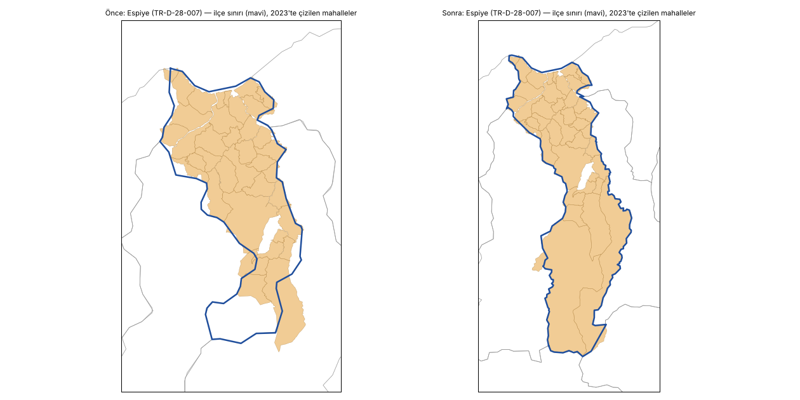
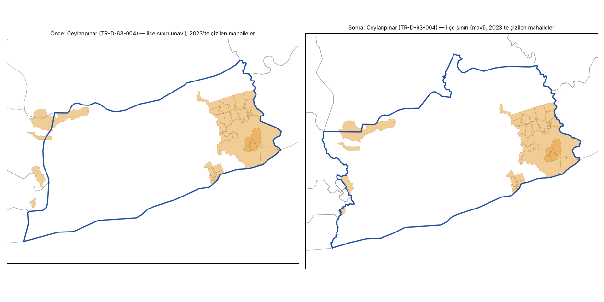
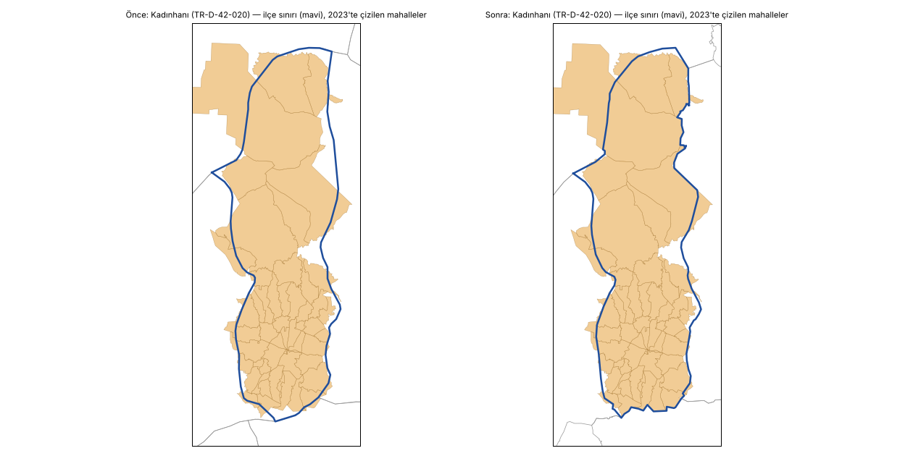

# İlçe katmanı yeniden üretimi — 1 Kasım 2026

`docs/rapor/GEOMETRI_DENETIMI.md` önerileri 5 ve 6 (ilçe katmanını topolojiyi koruyarak yeniden üret, TKGM ile
uyuşmayan ilçeleri güncel idari sınırla karşılaştır) ve `HARITA_DUZELTME_2026-10-31.md`'deki "kalan 58 kayıt".
Önce/sonra sayıları aynı denetim betiğiyle (`scripts/rapor/geometri_denetimi.py`) `main` (d2f896b) ve bu dal
üzerinde ölçüldü.

## 1. Kısa özet

| Ölçü | Önce | Sonra |
|---|---|---|
| Kendi ilçesinden 2 km'den uzak duran mahalle poligonu (hepsi çiziliyor) | 58 | 9 |
| Mahalle alanının ilçesinin 2 km bandı dışında kalan kısmı | 10.929 km² (%1,46) | 2.887 km² (%0,39) |
| İlçe sınırının 2 km dışında kalan TKGM birim alanı (bağımsız kaynak) | 10.950 km² | 2.924 km² |
| Bu alan > 10 km² olan ilçe | 270 | 74 |
| TKGM ↔ ilçe IoU, medyan | 0,81 | 0,89 |
| Komşu ilçeler arası dikiş boşluğu | 6.062 (367 km²) | 1 (< 0,01 km²) |
| İlçe–ilçe örtüşmesi (≥ 1.000 m²) | 2.052 çift (399 km²) | 13 çift (0,1 km²; İstanbul'un kendi içinde, önceden vardı) |
| İl ↔ ilçelerinin birleşimi, simetrik fark (medyan / en çok) | %0,59 / %2,03 | %0 / %0 |
| Ülke: il birleşimi ↔ ilçe birleşimi, simetrik fark | 1.542 km² | 0,2 km² |
| Geçersiz ilçe / il poligonu | 24 / 8 | 0 / 0 |
| Dönem il dosyaları: iller arası örtüşme | 140–358 km² | 0,1–9 km² |
| Tarihsel ilçeler: parçalarının dışına taşan alan | 309 km² | 71 km² (İstanbul, değişmedi) |
| 2023 genel: poligonu olan seçmen | 57.470.331 (%94,56) | 57.509.570 (%94,63) |
| `turkiye_ilce_sinirlari.geojson` | 1.426.378 bayt (73.826 nokta) | 3.137.527 bayt (170.023 nokta) |
| Tek dosyalık `index.html` | 40.756.814 bayt | 44.879.330 bayt (+4,1 MB) |
| Pages `site/dist/` (`geo/`) | 209,2 MB (49,2 MB) | 220,2 MB (60,2 MB) |

Kök neden sadeleştirme değildi: ham HDX dosyası da (663.098 nokta) TKGM ile aynı ölçüde uyuşmuyor (2 km dışı
10.891 km²; sadeleştirilmiş dosya 10.950 km²). Yani yalnız daha az sadeleştirmek 58 kaydı çözmezdi; sınırın
kendisi o ilçelerde eski/yanlış. OpenStreetMap'in güncel ilçe sınırları TKGM ile çok daha uyumlu çıktı.

## 2. Kaynaklar

| Kaynak | Ne için | Lisans |
|---|---|---|
| HDX COD-AB-TUR (OCHA), `ttezer/turkiye-harita-verisi` commit `83eeb7a1` içindeki kopyası, `dist/geojson/districts.geojson` (sha256 `16fb6b98…af067ad`) | Önceki katmanın ham kaynağı (`geo/raw/PROVENANCE.md`'deki pin ile aynı commit). 973 ilçe, aynı `TR-D-*` kimlikleri, komşu ilçeler birebir ortak sınırlı. | CC BY-IGO |
| OpenStreetMap `boundary=administrative`, `admin_level=6` (`data/raw/osm/ilce/`, 975 ilişki, 973 ilçenin hepsiyle eşleşti) | Güncel ilçe sınırı | ODbL 1.0 |
| TKGM idari birimleri (`data/raw/tkgm/mahalle/`, 47.001 birim, ilçesi TKGM'nin kendi kaydından) | Yalnız hakem: hangi kaynağın hangi ilçede doğru olduğuna ve iki kaynağın çakıştığı alanın kime ait olduğuna karar. Sınır çizgisi TKGM'den alınmadı (açık lisansı yok). | lisans dışı |

OSM verisi Overpass'tan GitHub Actions ile çekildi (`.github/workflows/osm-ilce-cek.yml`, `fetch_osm_ilce.py`;
`osm-ilce-veri` dalı; Overpass ilk çalıştırmada Bursa, ikincide Gümüşhane ve Samsun için boş döndü, yeniden
çekildi). Geliştirme ortamından Actions artifact'ları indirilemediği için (blob deposu 403) sonuç veri dalına
yazılıyor.

## 3. Yöntem (`scripts/pipelines/ilce_katmani/`)

1. **Kaynak seçimi** (`ilce_duzeltme_sec.py` → `geo/normalized/ilce_duzeltme.json`,
   `docs/rapor/ilce_katmani/ilce_karsilastirma.csv`). Her ilçe için TKGM birimlerinin HDX ve OSM poligonunun
   2 km dışında kalan alanı ölçüldü. OSM en az HDX kadar uyumluysa (fark ≤ 1 km²) sınır OSM'den: **803 ilçe**.
   OSM daha kötüyse HDX kalır ve ortak sınırda önce gelir: **131 ilçe** (ör. Toroslar: HDX 115 km², OSM 237 km²).
   İstanbul'un 39 ilçesi seçime girmez (aşağıda). İlk denemede yalnız belirgin farklı ilçeler (≥ 10 km² ve OSM'de
   yarısından az) değiştirildi; komşuların da değişmesi gerekti ve yayılma 773 ilçeye ulaştı. Yamalı bir
   katman yerine kural bütün ilçelere aynı uygulandı.
2. **Düzlemsel bölümleme** (`build_ilce_katmani.py`). Aday (OSM/HDX/İstanbul) ve HDX sınırları düğümlenip
   yüzlere ayrıldı. Kaynaklar bir yüzü aynı ilçeye veriyorsa o ilçenin; farklı ilçelere veriyorsa (iki aday,
   ya da OSM adayı ile HDX) yüzün en az yarısı bir ilçenin TKGM birimleriyle kaplıysa (ve ötekinden 0,25 fazla)
   o ilçenin (17.139 yüz), değilse öncelik (HDX-öncelikli > OSM > eşleşmesiz HDX; 5.791 yüz). Hiçbir adayın
   kapsamadığı yüz TKGM'ye, sonra HDX sahibine, sonra en uzun ortak sınırlı komşuya; komşusu olmayan ada HDX
   sahibine (OSM sınırının dışarıda bıraktığı adalar, ör. Urla açıkları; 113 yüz). Kıyı çizgisi HDX'inki (OSM sınırları denize taşabiliyor; ülke = HDX
   birleşimi).
3. **Ortak yay sadeleştirme.** Sınır ağı yaylara ayrıldı, her yay uçları sabit Douglas-Peucker 0,001° (~100 m)
   ile sadeleştirildi, 4 ondalığa yuvarlandı, yeniden yüzlere ayrıldı. Komşu ilçeler aynı yayı paylaşır: dikiş
   boşluğu ve örtüşme yok.
4. **İl katmanı** = ilçelerin il il birleşimi; il ile ilçe sınırları birebir aynı.
5. **İstanbul aynen korundu.** Tarihsel İstanbul katmanları (`HIST-Istanbul-*`, `ortusmeleri_temizle.py`) bugünkü
   İstanbul ilçelerine göre kuruldu ve onları yeniden üreten betik (`prepare_istanbul_historical_assignments.py`)
   2026-10-31 mahalle düzeltmesinden beri `main`'de çalışmıyor (`KeyError: 'BALABAN MAH.'`). İstanbul'a değen
   yaylar sadeleştirilmedi; Kocaeli ve Tekirdağ ortak sınırı İstanbul'dan aldı. İstanbul'un kendi içindeki eski
   ince boşluk ve örtüşmeler (13 çift, 0,1 km²; 4,3 km² delik) olduğu gibi kaldı.
6. **Tarihsel sınırlar** (`tarihsel_yeniden_tabanla.py`). 849 tarihsel ilçe birleşimi (HIST/HISTK/HISTY/HIST<seçim>)
   yeni parçalarının (`district_splits.json` `hideIds`) birleşimiyle yenilendi; parçası İstanbul'da olan 70 kayıt
   değişmedi. Dönem il dosyaları: era1950–era1994 `build_il_sinirlari.py` ile seçim verisinden yeniden, era1995 ve
   era1999 her bugünkü ilçenin eski dosyada düştüğü ile göre. `tarihsel_sinirlari_uret.py` çalıştırılmadı: seçim
   verisine de yazıyor ve `main`'de `merkez_ilce_tamamla.py` adımında duruyor. Kimlikler ve seçim kayıtları
   değişmedi.
7. **Mahalle eşleştirmesi** (`tkgm_muhtarlik_esle.py uygula`, 15 seçim). Konum kuralı, OSM mahalle poligonlarının ve
   OSM yer noktalarının ilçeye atanması ilçe katmanına bağlı; bütün seçimler yeniden işlendi. İkinci ve üçüncü
   çalıştırma bayt bayt aynı (`mahalle_geo.json`, `data/normalized/mahalle/`, `docs/rapor/mahalle_eslesme/`).
   İlk çalıştırma ile ikinci arasında yalnız rapor CSV'leri farklı: ilk çalıştırmada reddedilip silinen eski
   poligonlar ikinci çalıştırmada artık aday değil (veri aynı).

Her betik tekrar çalıştırılabilir: `build_ilce_katmani.py` iki kez çalıştırıldığında il ve ilçe dosyaları bayt bayt
aynı; `tarihsel_yeniden_tabanla.py` da öyle.

## 4. Sonuç: 58 kayıt

Denetim özeti 58 → 9 sayıyor; CSV'de (`mahalle_yanlis_ilce.csv`) bunlar 56 ve 8 satır. 56 satırdan 48'inin poligonu değişmeden artık kendi ilçesinde;
Oğuzeli "Şahinbey"in TKGM birimi yerine doğru ilçedeki OSM sınırı alındı; 7'si kaldı. 1 yeni kayıt var (Alanya
Cikcilli, 2,25 km). Kalanların hepsinde mahallenin kaynağı (TKGM birimi ya da belediye/MAKS poligonu) ile iki
bağımsız sınır kaynağı (HDX ve OSM) aynı alanı farklı ilçeye veriyor; üçüncü bir kaynak olmadığı için tahmin
yapılmadı:

| Mahalle (kaynak) | Poligonun düştüğü ilçe | Uzaklık | Not |
|---|---|---|---|
| Çukurca Cevizli (TKGM) | Hakkâri Merkez | 3,7 km | HDX ve OSM'de alan Merkez'de |
| Elmalı Yuva (ttezer) | Seydikemer (Muğla) | 3,1 km | il sınırı; HDX ve OSM aynı |
| Bayat Bayan (TKGM) | Çorum Merkez | 3,0 km | |
| Finike Akçaalan (ttezer) | Kumluca | 2,8 km | Finike HDX-öncelikli |
| Murgul Petek (TKGM) | Arhavi | 2,6 km | Murgul HDX-öncelikli |
| Kadınhanı Başkuyu-Fatih (TKGM), Başkuyu (ttezer) | Yunak | 2,5 km | TKGM ve Konya MAKS Kadınhanı diyor, HDX ve OSM Yunak |
| Alanya Cikcilli (ttezer, yeni) | Hadim (Konya) | 2,3 km | 24,5 km²'lik dağlık poligon; Cikcilli kıyıda bir mahalle, MAKS etiketi şüpheli |

Kadınhanı'nın TKGM uyumsuzluğu (176 km²) bu yüzden sürüyor; Bolu Merkez (139 → 102 km²), Toroslar (115 → 111),
Elmalı (89 → 79) ve Çukurca (88 → 80) kısmen düzeldi. Öteki örnekler: Ceylanpınar 285 → 10 km², Çağlayancerit
167 → 4, Espiye 149 → 0, Karapınar 135 → 2, Eruh 125 → 25, Alanya 119 → 18, Akseki 115 → 4, Beyşehir 124 → 0.

## 5. Seçmen kapsamı

| Seçim | Önce | Sonra | Fark |
|---|---|---|---|
| 2009 yerel | 34.726.879 (%87,44) | 34.741.153 (%87,48) | +14.274 |
| 2010 referandum | 44.001.778 (%88,90) | 44.019.363 (%88,94) | +17.585 |
| 2011 | 44.683.280 (%88,94) | 44.703.207 (%88,98) | +19.927 |
| 2014 CB | 49.866.521 (%94,23) | 49.896.658 (%94,29) | +30.137 |
| 2014 yerel | 46.051.843 (%94,16) | 46.080.244 (%94,22) | +28.401 |
| 2015 Haziran | 50.673.588 (%94,24) | 50.704.863 (%94,29) | +31.275 |
| 2015 Kasım | 50.982.386 (%94,26) | 51.013.925 (%94,32) | +31.539 |
| 2017 referandum | 52.207.717 (%94,22) | 52.240.782 (%94,28) | +33.065 |
| 2018 / 2018 CB | 53.142.433 (%94,21) | 53.177.627 (%94,28) | +35.194 |
| 2019 yerel | 50.339.553 (%94,55) | 50.370.376 (%94,61) | +30.823 |
| 2023 / CB 1. tur | 57.470.331 (%94,56) | 57.509.570 (%94,63) | +39.239 |
| 2023 CB 2. tur | 57.515.900 (%94,56) | 57.555.183 (%94,63) | +39.283 |
| 2024 yerel | 54.668.847 (%94,80) | 54.706.132 (%94,87) | +37.285 |

Kazanılanlar iki türlü: (a) eski katmanda yanlış ilçeye atanan OSM mahalle poligonları artık doğru ilçede ve adla
eşleşiyor (Talas Yenidoğan 18.296 seçmen, Melikgazi Yeşilyurt, Pamukkale 15 Mayıs, Karesi Hacı İsmail, Yalıhüyük
Aşağı, Hasankeyf Eyyubi, Oğuzeli İnönü ve Mimar Sinan ...); (b) 31 Ekim'de konum kuralıyla boş bırakılan 20
muhtarlıktan 11'i doğru ilçede sınır buldu (Okçular, Yanıkses, Kayıklı, Kocalar, Karlıca, İncehıdır, Ericek,
Seydiköy, Kasnakçımermer, Arabuk, Oğuzeli Mimar Sinan). Kalan 9'unun (Ayvatlı, Camii, Ekmekçi, Sofular, Yeşildere,
71 Evler, Ardıçlıtaş ...) tek aday poligonu hâlâ başka ilçede. Yeni boşalan 1 muhtarlık: Batman Merkez Yolağzı
(118 seçmen; OSM konum adımı yeni sınırla belirsiz kaldı, kural gereği boş). Konum kuralı 38 aday reddetti
(önce 61); Erzurum İspir Başköy'ün OSM sınırı (aslında Rize İkizdere'deki Başköy) ve Trabzon Maçka Ortaköy'ün
Düzköy'e taşan belediye poligonu artık alınmıyor, ikisi de doğru ilçedeki TKGM birimine geçti.

Yeni eşleşen muhtarlıklardan birkaçında YSK verisinde katılım %100'ü aşıyor (Eruh Yanıkses %138, Gördes
Kuyucakkarapınar, Şehzadeler Kaleköy, Bayburt Karlıca); veri denetimi listesi yenilendi (kaynak kaynaklı).

## 6. Dosya boyutu

| Dosya | Önce | Sonra |
|---|---|---|
| `geo/normalized/turkiye_ilce_sinirlari.geojson` | 1.426.378 | 3.137.527 |
| `geo/normalized/turkiye_il_sinirlari.geojson` | 278.245 | 1.158.326 |
| `geo/historical/turkiye_ilce_sinirlari_hist_splits.geojson` | 2.309.786 | 5.002.886 |
| `geo/historical/turkiye_il_sinirlari_era*.geojson` (9) | 4.161.750 | 9.865.000 |
| `geo/normalized/mahalle_geo.json` | 88.536.624 | 88.585.789 |
| `data/raw/osm/ilce/` (yeni) | — | 9.773.798 |
| Tek dosyalık `index.html` | 40.756.814 | 44.879.330 |

Tolerans 0,0005° (~50 m) ile ilçe dosyası 4,7 MB, il 1,7 MB oluyordu; 0,001° seçildi (harita ölçeğinde fark
görünmüyor, sapma yine eski dosyadan az).

## 7. Doğrulama

| Kontrol | Sonuç |
|---|---|
| `scripts/validate.py` | geçti |
| `scripts/validate_public_data.py` | geçti |
| `tests/validate_elections.py` (`scripts/build.py` sonrası) | 21/21 (tarihsel ilçe örtüşme/delik 1.430 senaryo, seçim ilçe eşleme 26 seçim dahil) |
| `node --test tests/*.test.cjs` (`site/build.py` sonrası) | 14/14 |
| `cd site && node tests/loading.test.cjs` | 30/30 |
| `veri_denetimi.py --kontrol` | yeni bulgu yok (liste yenilendi: yeni eşleşen muhtarlıkların YSK kaynaklı katılım/geçerli oy bulguları) |
| Eşleştirme tekrarlanabilirliği | 2. ve 3. `uygula` bayt bayt aynı |
| Katman tekrarlanabilirliği | `build_ilce_katmani.py` ve `tarihsel_yeniden_tabanla.py` ikinci çalıştırmada aynı |
| Ekran görüntüleri (Playwright, önce/sonra; oturum klasöründe) | Kadınhanı, Ceylanpınar, Alanya, Espiye mahalle haritası; Konya ve Şanlıurfa il haritası; 1961 ülke, 1987 Konya, 1995 İstanbul tarihsel haritaları çiziliyor |

`docs/rapor/GEOMETRI_DENETIMI.md` bu dalla yeniden üretildi (betikteki sabit örnek metinleri sayılardan
üretilecek biçimde düzeltildi). `docs/rapor/ozet.json` (`harita_durum_raporu.py`) alan payları değişti.

## 8. Açık işler

- Kalan uzak kayıtlar (bölüm 4): TKGM/MAKS ile HDX+OSM çelişiyor. Yerinde ya da resmî ilçe sınırıyla (TKGM
  ilçe katmanı, İçişleri) doğrulanmadı.
- OSM'nin TKGM ile daha kötü olduğu 131 ilçede HDX duruyor; bunların bir kısmında TKGM uyumsuzluğu sürüyor
  (Toroslar 111 km², Bolu Merkez 102 km²).
- İstanbul ilçeleri eski (HDX %8 sadeleştirilmiş) geometride. Tarihsel İstanbul betikleri yeniden
  çalıştırılabilir hâle gelince İstanbul da aynı yöntemle üretilebilir (`KORUNAN_IL`).
- `tarihsel_sinirlari_uret.py` `main`'de çalışmıyor (`merkez_ilce_tamamla.py` ve İstanbul adımı); bu çalışmanın
  konusu değil.
