# Türkiye Seçim Haritası — Veri ve Yöntem Raporu

12 Ekim 2026

## Özet

Türkiye Seçim Haritası, 1950–2024 arasındaki 46 seçimin sonucunu il, ilçe ve 15 seçimde mahalle düzeyinde gösteren, tek dosyada da çalışan bir web haritasıdır. Bu rapor verinin nereden geldiğini, nasıl okunduğunu, hangi klasöre yazıldığını, nasıl karşılaştırılıp doğrulandığını ve haritanın nasıl üretildiğini anlatır. Tüm bilgiler deponun 12 Ekim 2026 tarihli hâlinden (v1.0 ve aynı gün eklenen özellikler, commit `138c90a`) alındı.

Veri tek yönde akar: **kaynak belge → ham kopya (`data/raw/`) → kaynak başına ayrıştırılmış tablo (`data/kaynaklar/`) → birleştirilmiş, kayıpsız veri (`data/normalized/`) → yayın dosyaları → site**. Hiçbir sayı sitenin HTML'inde elle düzeltilmez; bir düzeltme her zaman kaynağa yakın bir katmanda yapılır ve hat yeniden çalıştırılır.

| Seçim türü | Satır | Tam (≥ %99,5) | Eksik kalanlar |
| --- | --- | --- | --- |
| Genel seçim | 20 | 17 | 1950, 1954, 1957: yalnız il düzeyi, ilçe kaynağı yok |
| Referandum | 7 | 7 | — |
| Cumhurbaşkanlığı | 4 | 4 | — |
| Yerel seçim (başkanlık, belediye meclisi, il genel meclisi ayrı) | 45 | 22 | Çoğu 1950–1984 meclis sonuçları |

Kaynak: `docs/rapor/KAPSAM_TABLOSU.md` (`scripts/rapor/kapsam_tablosu.py` üretir). Toplam 76 satırın 50'si tam, 7'si büyük ölçüde tam (≥ %90), 3'ünün kaynağı yok. Tabloda "araştırılmadı" görünen 4 satırın hepsi yerel seçim meclis sonuçlarıdır (belediye meclisi ve il genel meclisi):

- **1950 ve 1955 (4 satır):** Bu yıllar için DİE kitabı yok; kaynak ancak Cumhuriyet Arşivi belgelerinde aranabilir.

Bu seçimlerin belediye başkanlığı sonuçları haritada var; eksik olan yalnız meclis haritalarıdır.

v1.0'dan sonra siteye beş özellik eklendi: il ve ilçe için seçim geçmişi grafiği, iki seçimi yan yana karşılaştırma, habere gömme, açık veri sayfası ve paylaşım önizlemesi. Ayrıntıları "v1.0 sonrası eklenen özellikler" bölümünde.

## Veri kaynakları

Verinin omurgası resmî kaynaklardır: 2009 sonrası her şey YSK'nin açık veri API'sinden, 1950–2007 il sonuçları YSK arşivinden, 1961–1987 ilçe sonuçları ve eski yerel seçimler TÜİK/DİE kitaplarından gelir. Vikipedi ve GitHub tabanları yalnız resmî kaynağın olmadığı yerde kullanılır ve mümkün olan her yerde resmî kaynakla karşılaştırılır.

| Kaynak | Sınıf | Neyi besliyor | Nasıl erişildi |
| --- | --- | --- | --- |
| YSK Açık Veri Portalı (`acikveri.ysk.gov.tr`) | A | 2009 sonrası tüm seçimler (genel, yerel, CB, 2010/2017 referandum), il + ilçe + mahalle | `getSecimSandikSonucList` API'siyle 998 ilçenin sandık sonuçları çekilip toplandı |
| YSK arşiv PDF'leri (`ysk.gov.tr`) | A | 1950–2007 genel seçimlerin il sonuçları ve vekil dağılımı; 1994/1999/2004 yerel il, ilçe ve meclis tabloları | İl başına PDF indirildi, metin katmanından okundu |
| TÜİK/DİE kitapları (TÜİK kütüphanesi) | A | 1961–1987 genel seçim ve referandum ilçe sonuçları; 1963–2004 mahalli seçim kitapları (1963–1977 meclis haritaları ve başkanlık sayılarının teyidi) | Taranmış PDF'ler `data/raw/tuik/` altına kondu, OCR ve çoklu okumayla çıkarıldı |
| mertnuhoglu/secim\_verileri (GitHub) | D, TÜİK ile teyitli | 1991–2007 genel seçim ilçe sonuçları (taban) | Pinlenmiş kopya, TÜİK ile satır satır karşılaştırıldı |
| Türkçe Vikipedi | D | 1950–1989 yerel seçim başkanlık sonuçları (il başına alt makaleler) | Sayfa tabloları ayrıştırıldı; 1963–1989 satırlarının sayıları DİE kitaplarıyla teyit edildi ya da düzeltildi |
| Habertürk | C | Yalnız 2023 genel ve CB seçimlerinin yurtdışı toplamı | Diğer tüm kullanımları 22–23 Eylül 2026'da YSK ile değiştirildi |
| ttezer/turkiye-harita-verisi, OpenStreetMap | Geometri | Güncel il, ilçe ve mahalle sınırları | Pin bilgisi `geo/raw/` altında, dosyalar yeniden indirilebilir |

Sınıflar görev tanımındaki ölçekten: **A** birincil/resmî, **B** güçlü ikincil, **C** destekleyici ikincil, **D** zayıf/keşif. D sınıfı bir rakam, başka bir kaynakla doğrulanmadan "tam" sayılmaz; kapsam tablosu bu yüzden DİE kitabıyla teyit edilemeyen Vikipedi satırı taşıyan seçimleri (1963–1984, 1999 başkanlıkta küçük bir pay, 2009) "tam ama zayıf kaynaklı" diye ayrı işaretler.

Her seçimin birincil ve yedek kaynağı makine-okunur biçimde `sources.yml`'de, okunabilir özeti `SOURCES.md`'de, nerelerde arandığı ve bulunamadığı `data/kaynaklar/ARASTIRMA_KAYDI.md`'de durur. Tek bir ilçenin değerinin hangi kaynaktan geldiğini görmek için:

```bash
python3 scripts/kaynak.py 1995 İstanbul Fatih
```

## Veriler nasıl alındı

Veri altı farklı yolla çekildi; kaynak dijitalleştikçe yöntem basitleşir. 2009 sonrası API'den doğrudan toplanır, 1950–2007 PDF metninden okunur, 1960'lar–1990'ların yerel seçimleri ise taranmış kitaplardan, birden çok okuma motoruyla ve "tahmin yok" kuralıyla çıkarılır.

| Yol | Seçimler | Betik | Ham çıktı |
| --- | --- | --- | --- |
| YSK açık veri API'si | 2009–2024 genel, yerel, CB; 2010 ve 2017 referandum | `scripts/pipelines/election_import/` (`fetch_and_aggregate.js`, `fetch_yerel_v2.js`) | `data/raw/ysk/` |
| YSK arşiv PDF'leri (metin katmanı) | 1950–2007 genel seçim il sonuçları; 1994–2004 yerel il ve ilçe | `genel_1950_1977/parse_ysk_pdfs.py`, `genel_1983_2007/`, `yerel_1994_1999_2004/` | `data/raw/ysk/1950-1977/`, `1983-2007/` |
| TÜİK Seçim Dağıtım uygulaması (HTML rapor) | 1961–1987 genel seçim ilçe sonuçları | `genel_ilce_1961_1987/fetch_tuik_ilce.py` (7 seçim × 67 il = 469 dosya) | `data/raw/tuik/secimdagitimapp-ilce-1961-1987/` |
| DİE taranmış kitapları | 1984, 1989, 1994, 1999, 2004 yerel (başkanlık, meclis, il genel meclisi); 1968, 1973 ve 1977 yerel (meclis, il genel meclisi); 1961–1988 referandumlar | `scripts/pipelines/tuik_arsiv/` (`extract_mahalli*.py`, `extract_halkoylamasi.py`) | `data/raw/tuik/mahalli-kitap/`, `halkoylamasi-0018260/` |
| Vikipedi il sayfaları | 1950–1989 yerel başkanlık sonuçları | `wikipedia_arsiv/fetch_wikipedia.py`, `extract_yerel.py` | `data/raw/wikipedia/` |
| YSK API, sandık → mahalle | 15 seçimde mahalle/muhtarlık düzeyi | `mahalle_veri/` (Node + Playwright) | `data/normalized/mahalle/` |

### YSK API'den toplama (2009 sonrası)

1. `fetch_il_ilce_list.js`, `getIlceList` ile 81 ilin 998 ilçe kimliğini çeker.
2. `match_ilce_geomid.py` bu ilçeleri ad ve plakayla haritadaki 973 ilçeye eşler; eşleşmeyenler ya eski "Merkez" kimlikleri ya da oyu olmayan boş kayıtlardır.
3. `getSandikSecimSonucBaslikList` her seçimin hangi sütununun hangi partiye ait olduğunu verir.
4. `getSecimSandikSonucList` her ilçenin sandık sonuçlarını döndürür; bunlar ilçe ve il toplamına eklenir.
5. Yerel seçimde ilçeleri toplamak yanlış sonuç verir, çünkü her ilçe ayrı yarıştır. Bu yüzden büyükşehirlerde il sonucu büyükşehir yarışından, diğer illerde il merkezinin kendi yarışından alınır. Örneğin İstanbul 2019'da ilçeleri toplamak %45,9'a %40,3 gibi sahte bir fark üretiyordu.

### Taranmış kitaplardan okuma (DİE)

Her kitabın farklı bir sorunu var: 2004 dijital dizgi, 1989 ve 1994/1999 OCR metin katmanlı tarama, 1984 ise zayıf OCR'lı ve eğik tarama. Hepsinde ortak kurallar:

- **Tahmin yok.** Okunamayan hücre boş kalır; eksik bir parti oyu toplamdan geri hesaplanmaz.
- **İç tutarlılık şartı.** Bir satır ancak parti oyları toplamı geçerli oya eşitse, her partinin kitaptaki yüzdesi tutuyorsa ve katılım oranı tutuyorsa `tutarli` sayılır. Haritaya yalnız bu satırlar girer.
- **Kimlik şartı.** Satırın hangi belediye olduğu YSK arşivindeki sandık ve seçmen sayısıyla birebir eşleşerek bulunur. Eşleşmezse satır işlenmez.
- **Sütun kayması kontrolü.** Yüzde kontrolleri, değer ve yüzdesi birlikte kaydığında hatayı yakalayamaz. Bu yüzden hücre konumu sütun kenarından fazla uzaksa satır şüpheli işaretlenir.

**1984 için üç, sonra dört bağımsız okuma** kuruldu: PDF metin katmanı, macOS Vision ve tesseract. Her hücre için üç aday değer çıkar; satırdaki sıfır olmayan oy alanlarından en fazla biri tek okumaya dayanabilir. Bu kural, iki yanlış okumanın birbirini dengelediği durumu dışlar: 1984 Van belediye meclisinde geçerli oy ve ANAP ikisi de 2.000 eksik okunmuştu, toplam yine de tutuyordu. Dördüncü okuma, sayfa görüntüsünden kırpılan şeritlerin gözle okunmasıdır.

**1963–1977 kitapları** (DİE 0015160, 0015244, 0015468 ve 0015740, `extract_mahalli_1963_1977.py`): her kitapta üç tablo okundu: il genel meclisi, belediye meclisi ve belediye başkanlığı. 1973 ve 1977'de tablolar iki yüzlü (sol: sandık, seçmen, oy kullanan, katılım, geçerli ve ilk partiler; sağ: diğer partiler). Metin katmanı (ABBYY) rakamların arasına boşluk koyduğu ve bazı sayfalarda tamamen bozuk olduğu için tutmayan satırlar sayfa görüntüsünden tesseract'la yeniden okunur (`goruntu_okuma.py`). Bir parti oyu yalnız kitabın aynı satırdaki yüzdesini tutuyorsa seçilir; satır yine toplam, yüzde ve katılım şartından geçmelidir. Yüzdesi tutmayan hücre toplamdan geri hesaplanmaz. Eski okuyucu bunu yapıyordu: 1977 Bartın'da sağ yüz eşleşmeyince AP 1 969 ile Bağımsız 6 toplanıp AP 1 975 yazılmıştı. Bu kural kapatılınca 1968–1977 meclis kapsamı yaklaşık %5 düştü. Satır kimliği şöyle kurulur: il genel meclisi satırı kitap sırası ve aynı yılın genel seçim ilçe seçmeniyle tanınır; belediye meclisi satırı başkanlık kaydındaki sandık ve seçmenle (ya da kitapta okunan ad ve %3 içinde seçmenle) tanınır. Kitabın Yanlış–Doğru Cetveli uygulandı. Kitapta adı birebir okunan ilçe satırı genel seçim seçmeniyle karşılaştırılmaz (1973 Kozan'da kitap 344 227 seçmen basmış, il toplamı da onunla tutuyor). İç kontrolden geçmeyen il satırı, her parti oyu ve geçerli oyu ilin ilçe ve belde satırlarının toplamına birebir eşitse teyitli sayılır; parti toplamı ile geçerli oy arasındaki fark kitabın kendisindedir, notla gösterilir. 1977 taramasında kitabın 189–194. sayfaları yok: belediye meclisinde Sakarya'nın sonu–Trabzon (8 il) boş.

1968 kitabı il fasikülleridir. Tablolar tek yüzlü; ilçe satırı kitap sırasını veren kodla ('02 Ceyhan'), belde satırı bucak-köy koduyla ('1.014 Hacılar') yazılır. Ciltte sayfa sırası bozuk olabildiği için her sayfa kendi il başlığıyla ("35 — İZMİR") bağlanır. Belediye meclisi ve başkanlık tablolarında parti yüzdesi yok; toplam, oyun yanlış partiye yazılmasını yakalamaz. Bu yüzden parti sütunları tablo başlığından (AP, BP, CHP, CKMP, GP, MP, TİP, YTP, Bağımsızlar) kurulur. Sayılardan çıkan sütun kenarı seyrek sütunlarda kayıyordu: Denizli'de GP 215, MP'ye yazılmıştı. 1963 kitabında da yüzde yok. Kimlik sütunları (sandık, seçmen, oy kullanan) sol sayfada, sonuç (geçerli ve partiler) karşı sayfadadır; iki sayfanın ortak sütunu yoktur. Satırlar dikey konumla eşlenir. İki sayfa arasındaki kayma, geçerli oyun oy kullananın %80–100'ü olduğu eşleşmeyi en çok veren kaymadır. Bir satır kayması da eşit aralıklı satırların çoğunu eşlediği için yalnız konum yetmiyordu: Lapseki'ye İmroz'un sonucu yazılıyordu. Her satırda da bu oran aranır; oy kullanan okunamazsa eşleşme doğrulanmış sayılmaz. Parti sütunları sağ sayfanın başlığından kurulur; başlığı okunamayan sayfanın satırları kullanılmaz. 1963 ve 1968 belediye meclisinde parti oyları toplamı çoğu satırda geçerli oydan az basılmış (çoğunlukla %10–30; kitabın açıklaması farkların tutanaktaki gibi basıldığını söylüyor). Bu satırlar yalnız her hücre ve geçerli oy metin katmanı ile sayfa görüntüsünde aynı okunduysa, fark notuyla gösterilir (toplam geçerliden fazlaysa en çok %2). Sonuç (ilçe): 1963 il genel meclisi 380/620, belediye meclisi 180/620; 1968 477/619 ve 407/619; 1973 522/620 ve 508/620; 1977 501/621 ve 457/621.

**1963–1977 başkanlık** (`merge_baskanlik_1963_1977.py`): kayıt satırları Vikipedi il sayfalarından gelir; o sayfalar bu kitapları kaynak gösterir. Kitabın başkanlık satırı kayda yalnız kimliği kesinse bağlanır: aynı ilde sandık ve seçmeni birebir aynı tek satır, ya da en az üç partinin oyu birebir aynı tek satır, ya da kitapta okunan ad. Bağlanan satır iç kontrolden geçtiyse parti oyları ve geçerli oy kitaptan yazılır. Sandık, seçmen ve katılım yalnız kitabın katılım yüzdesi tutuyorsa yazılır. Değişen her alan `kaynak.farklar`'da eski ve yeni değeriyle durur, değişmeyen satır `kaynak.teyit` alır. Tutmayan satır işlenmez, nedeni `kaynak.tuikKullanilmadi`'da yazılır. Kitapta "Bağımsızlar" sütunu bütün bağımsız adayların toplamıdır. Bu yüzden kazanan oy sırasından hesaplanmaz. 1973'te kitabın kendi "seçimi kazanan ... partisi" sütunu kullanılır (842 satırda oylarla aynı; Elazığ'da Bağımsızlar %48,4 ama kazanan AP). Öteki yıllarda kayıttaki aday bazındaki kazanan, kitabın oylarıyla çelişmiyorsa korunur. Kayıtta kazanan bilerek en çok oyu alan değilse (mazbata iptali: 1963 İstanbul, 1968 Giresun ve Tokat; satırın notunda) kitabın oyları kazananı değiştirmez. Bir parti bütün bağımsızlardan çok oy almışsa kazanan odur. Kazanan belirlenemeyen satır işlenmez. Kazanan en çok oyu alan değilse (Bağımsızlar toplamı daha büyük) panelde not durur. Sonuç: teyitli satır payı 1963 %25, 1968 %50, 1973 %75, 1977 %65; kazananı değişen birim 1963'te 1 (Feke), 1968'de 2 (Dörtyol, Akyazı), 1973'te 8 (Akseki, Tutak, Mengen, Karakoçan, İspir, Tekman, Bozcaada, Ovacık; hepsinde kitabın kazanan sütunu), 1977'de 4 (Genç, Posof, İnebolu, Köyceğiz). Satır işlenince Vikipedi sayfasının toplam satırına ve tek bağımsız adaya dair eskiyen notlar `kaynak.wikipediaNotu`'na taşınır. Satır satır sonuç: `data/kaynaklar/tuik/yerel/<seçim>/baskanlik_birlestirme.json`.

**Bağımsız doğrulama (kör okuma):** dört ayrı ajan 108 satırı yalnız sayfa görüntüsünden okudu. Otomatik okumanın değerlerini görmediler. Kazananı değişen bütün satırlar ve rastgele örnekler okundu. İlk tur üç hata yakaladı: 1963 satır kayması, toplamdan geri hesaplama ve 1968 seyrek sütunlar. Bunlar düzeltildikten sonra ikinci tur iki hata daha buldu: 1968 sütun kayması ve 1963'te sağ sayfada satırı olmayan birim (Maden'e Sivrice'nin sonucu düşmüştü). Son durumda kabul edilen 93 satırın hepsi kitapla birebir aynı. Doğrulanamayan 15 satır kayda işlenmedi.

Eski tek okumalı yöntem, tutmayan hücreyi toplamdan hesaplıyordu. Yeni okumayla karşılaştırınca bu yolla "tutarlı" sayılan 328 satırın 75'inin yanlış olduğu çıktı (ör. Savaştepe ANAP 1.476 değil 1.478).

## Veriler nereye yazıldı

Her katman bir klasördür ve her biri bir öncekinden üretilir; asıl doğru kaynak `data/normalized/` katmanıdır. Site ve tek dosyalık `index.html` bu katmandan otomatik üretilir, elle düzenlenmez.

Bir düzeltme her zaman bu zincirin olabildiğince başında yapılır, sonra alttaki adımlar yeniden çalıştırılır.

| Klasör | Ne tutar | Örnek dosya |
| --- | --- | --- |
| `data/raw/` | Kaynağın değiştirilmemiş kopyası: PDF, HTML, API yanıtı | `tuik/mahalli-kitap/0012953.pdf` (1984 kitabı) |
| `data/kaynaklar/` | Kaynak başına ayrıştırılmış JSON; aynı seçim için birden çok kaynak yan yana durur | `tuik/yerel/1984yerel/…`, `ysk/mahalli-meclis/` |
| `data/normalized/elections/` | Seçim türü başına klasör, seçim başına bir JSON (46 dosya) | `genel/1977.json` |
| `data/normalized/mahalle/` | 15 seçimin mahalle/muhtarlık sonuçları | `2023.json` |
| `data/normalized/meclis_harita/` | Belediye meclisi (`_bm`) ve il genel meclisi (`_igm`) haritaları | `1984yerel_bm.json` |
| `data/normalized/ek/` | Haritada olmayan ek kayıtlar: beldeler, senato, milletvekilleri, yenilenen seçimler | `yenileme_ara/` |
| `geo/normalized/` | Güncel il, ilçe ve mahalle sınırları | `turkiye_ilce_sinirlari.geojson` |
| `geo/historical/` | Dönem il sınırları ve ilçe eşleme tabloları | `turkiye_il_sinirlari_era1957_1987.geojson` |
| `docs/rapor/` | Üretilen raporlar: kapsam tablosu, kitap doğrulama | `KAPSAM_TABLOSU.md` |

### Bir seçim dosyasının içi

`data/normalized/elections/genel/1977.json` beş alandan oluşur: seçimin adı ve türü, toplam sandalye (450), haritada renklenecek büyük partiler ve iki liste: 67 il, 638 ilçe. Bir ilçe kaydı şöyledir:

```json
{"ad": "Bahçe", "plaka": 1, "geomId": "HISTK-80-001-c2e725",
 "secmen": 24145, "gecerliOy": 21013, "katilim": 89.3, "kazanan": "CHP",
 "oy": {"CHP": {"oy": 8291, "oran": 39.46}, "AP": {"oy": 5386, "oran": 25.63}, "MHP": {"oy": 4399, "oran": 20.93}, "…": "…"}}
```

`geomId` kaydı haritadaki poligona bağlar. `HISTK-` ile başlayan kimlik, bugün var olmayan, o döneme ait tarihsel bir ilçe poligonu demektir (bir sonraki bölüm). İl kayıtlarında bunlara ek olarak vekil dağılımı (`vekil`) bulunur.

### Bütünlük kayıtları

- Her veri klasöründe bir `checksums.sha256` vardır; `scripts/regenerate_checksums.py` bunları ve `data/provenance/checksums.json`'u yeniler. Bir dosya izinsiz değişirse doğrulama yakalar.
- Her klasörün `PROVENANCE.md`'si verinin nereden, hangi tarihte ve hangi betikle geldiğini yazar.
- Büyük kaynak dosyalar GitHub'ın 100 MB sınırına göre bölünür. Örneğin 120,7 MB'lık 1963 kitabı iki parçadır, `kitap_birlestir.py` birleştirip SHA-256'yı doğrular.

## Tarihsel ilçe sınırları nasıl kuruldu

Eski bir seçim bugünkü 973 ilçeyle çizilirse, o tarihte henüz var olmayan ilçeler boş kalır. Bu yüzden her seçim için "bugünkü ilçe → o seçimdeki ilçe" eşleme tablosu üretildi: sonradan kurulan bir ilçenin alanı, kurulmadan önce bağlı olduğu ilçenin oyuyla boyanır. 1977'de 973 güncel ilçenin 937'si bu eşlemeye kesin kaynakla bağlandı.

**Örnek:** Aladağ (Adana) 4 Temmuz 1987'de 3392 sayılı Kanunla kuruldu ve kanunun ek listesine göre bütün köyleri Karaisalı'dan geldi. Bu yüzden 1987 öncesi haritalarda Aladağ'ın alanı Karaisalı'nın sonucuyla boyanır.

1. **İdari olaylar toplandı.** İçişleri'nin ilçe kuruluş listesi ve kuruluş kanunlarının ek listeleri okunarak her ilçenin kuruluşu, ad değişikliği ve il değişikliği bir olay olarak kaydedildi (`administrative_events.json`, `build_idari_katman.py`).
2. **Her ilçenin soyu çıkarıldı.** Her güncel ilçe için hangi eski ilçelerden kaç köy, bucak ya da mahalle aldığı yazıldı (`district_lineage.json`).
3. **Kanun tarihi ile seçim tarihi ayrıldı.** Kanunla kurulan bir ilçe hemen seçime ayrı girmeyebilir. Örneğin 4 Temmuz 1987'de kurulan 97 ilçe, 29 Kasım 1987 seçimine ayrı girmedi. Bu yüzden her ilçede hem kuruluş tarihi hem ayrı olarak ilk görüldüğü seçim tutulur.
4. **Seçim başına eşleme tablosu üretildi.** `build_ilce_secim.py <seçim> tablo` komutu `geo/historical/idari/ilce_eslesme/<seçim>.csv` dosyasını yazar: güncel ilçe, o seçimdeki karşılığı, yöntem, güven ve kaynak.
5. **Poligonlar birleştirildi.** Aynı eski ilçeye bağlanan güncel ilçeler tek poligonda birleştirilir; çıkan tarihsel poligonun kimliği `HISTK-` ile başlar. Dönem il sınırları da (`turkiye_il_sinirlari_era*.geojson`) seçim verisindeki ilçe-il bağlılığından üretilir.

### Güven sınıfları

| Güven | Ne demek | 1961 | 1977 | 1991 | 2007 |
| --- | --- | --- | --- | --- | --- |
| `kesin` | Kanun ya da sayım kaynağına dayanır | 935 | 937 | 969 | 969 |
| `yaklasik` | Birimlerin en az %70'i tek eski ilçeden | 20 | 20 | 0 | 0 |
| `kaba` | En büyük pay ya da en uzun sınır komşusu | 17 | 16 | 4 | 4 |
| `şüpheli` | Kaynakla çelişen ya da doğrulanamayan | 1 | 0 | 0 | 0 |

Kaynak: `geo/historical/idari/ilce_eslesme/<seçim>.csv`, `guven` sütunu. Kaba eşlemeler README'de "kapsam dışı" olarak listeli; örneğin Çukurova'nın birimleri %58 Seyhan (o zamanki Merkez), %42 Karaisalı'dan geldiği hâlde bütünüyle Merkez'e bağlandı.

Tarihsel sınırları yeniden üretmenin tek doğru yolu `scripts/pipelines/historical_geo/tarihsel_sinirlari_uret.py` betiğidir. Tüm adımları doğru sırayla çalıştırır ve idempotenttir: iki kez çalıştırınca hiçbir dosya değişmez.

## Karşılaştırma ve doğrulama

Her önemli veri seti en az bir bağımsız kaynakla karşılaştırıldı ve fark bulunduğunda değer sessizce düzeltilmedi, kaydedildi. Bunun üzerine iki otomatik kontrol katmanı çalışır: her derlemede yapısal kontrol, her push'ta 18 analitik kontrol.

### Kaynaklar arası karşılaştırmalar

| Karşılaştırma | Ne neyle kıyaslandı | Sonuç |
| --- | --- | --- |
| 1994 ve 1999 yerel, DİE okuması | Kitaptan okunan başkanlık satırları ↔ YSK arşivi | 1994: 1.668/1.668, 1999: 1.815/1.815 satır birebir, 0 fark |
| 1999 il genel meclisi | Kitap okuması ↔ YSK kesin sonuç il toplamları | 72/72 ilde aynı sütun kayması yakalandı (DSP oyları DEMTP diye yazılmıştı); düzeltmeden sonra 72/72 birebir |
| 1984 meclis, dört okuma sonrası | Kabul edilen il satırları ↔ YSK kesin sonuçları (Resmî Gazete) | Belediye meclisi 30/31, il genel meclisi 43/44 il birebir; iki farkta YSK'nin kendi satırı tutarsız |
| 1983–2007 genel seçim | İl başına vekil toplamları ↔ YSK özet rakamı | 529 kaydın 528'i birebir; istisna Bingöl 1983, YSK belgesi kendi içinde tutarsız |
| 1950 genel seçim | YSK il PDF'lerinin toplamı ↔ YSK ulusal özet ↔ TBMM veritabanı | Üçü birbirinden %0,01–0,27 farklı; `sources.yml`'de kaydedildi, çözülmedi |
| 2002 Siirt | mertnuhoglu ilçe değerleri ↔ TÜİK ilçe tablosu | 7/7 ilçe birebir; "bozuk" sanılan sonuç 9 Mart 2003'te yenilenen seçimin resmî sonucu |
| 1963–1977 yerel başkanlık | Vikipedi satırları ↔ DİE kitapları | Aşağıdaki grafik (ilk, metin katmanı karşılaştırması); 26 Ekim 2026'da tam okumayla iç kontrolden geçen satırlar kayda işlendi (yukarıda, "1963–1977 başkanlık") |

Kitapla farklı çıkan satırlar, kitabın kendi yüzdesi ya da toplamıyla destekleniyorsa "destekli fark" sayılır; o zaman Vikipedi değeri büyük olasılıkla yanlıştır (ör. 1963 Adana il merkezi Bağımsız: depoda 877, kitapta 336). Bu farklar v1.0'da bilinçli olarak veriye işlenmemişti; 26 Ekim 2026'da kitabın tam okumasıyla işlendi (Adana il merkezi Bağımsız artık 336).

### Karşılaştırmanın kuralları

- **Kaynak kendi içinde tutarsızsa düzeltilmez, not edilir.** DİE bazı tutanakları olduğu gibi basmış; parti oyları toplamı geçerli oydan biraz farklı. Her alan iki okumayla teyitliyse ve fark %2'yi geçmiyorsa satır `toplamTutmuyor` durumuyla kabul edilir, fark satırın notunda görünür.
- **Başka seçimden değer aktarılmaz.** Örneğin Tillo'nun eksik başkanlık oyları başka bir seçimden doldurulmadı.
- **Ad benzerliğiyle eşleme kısıtlıdır.** OCR'da bozulan adlar ("GöLBASl") yalnız benzerlik ≥ 0,7 ise, ikinci adaydan en az 0,15 öndeyse ve kitaptaki sıraya uyuyorsa bağlanır. 1984'te 187 satır bu yolla bağlandı.

### Otomatik kontroller

| Kontrol | Ne zaman çalışır | Ne yakalar |
| --- | --- | --- |
| `scripts/validate.py` | Her `build.py` çalıştığında, derlemenin önünde | Eksik seçim anahtarı, boş il listesi, geometrisi olmayan ilçe ya da mahalle; hata derlemeyi durdurur |
| `tests/validate_elections.py` | Her push ve PR'da (`.github/workflows/validate.yml`) | 19 kontrol: checksum'lar, 20 yılın sandalye toplamları, kazanan partinin oy kaydı, seçim geçmişinin 973 ilçe × 17 seçimde eksiksiz olması, `index.html`'in kaynakla senkron olması, derlemenin bayt bayt tekrarlanabilmesi |
| `tests/*.test.cjs` (Node) | Elle ya da CI'da | 10 veri bütünlüğü testi: bağımsız oyların iki kez sayılmaması, Sakarya'nın 1957/1961 vekil çubuğunda olması, Tillo'nun sekiz meclis dosyasında bulunması |
| `site/tests/` | `cd site && npm test` | 27 tarayıcı testi: yükleme ve hata kurtarma, seçim geçmişi, karşılaştırmada ortak izdüşüm, gömülü görünüm, açık veri CSV'lerinin sayfadaki CSV ile bayt bayt aynı olması |

Son değişiklikten sonra hepsi çalıştırıldı: 19/19 analitik kontrol, 10/10 Node testi ve 27/27 site testi geçti; GitHub'daki `validate` ve `pages` iş akışları da başarılı. İki geometri kontrolü `shapely` kütüphanesi kurulu olmadığı için bu ortamda atlandı.

## Harita ve grafikler nasıl üretiliyor

Harita ve grafikler hiçbir dış kütüphane kullanmadan, tarayıcıda SVG olarak çiziliyor. Veri önce yayın dosyalarına dönüştürülüyor, site yalnız ihtiyaç duyduğu dosyayı açıyor ve her poligonu seçilen moda göre renklendiriyor.

### Derleme: veriden siteye

1. **`scripts/export_static.py`** normalize veriden yayın dosyalarını üretir: 46 seçim dosyası (`data/elections/<anahtar>.json`), mahalle oyları, meclis haritaları, güncel ve tarihsel sınırlar, 9 dönem il sınırı ve ilçe başına mahalle poligonları.
2. **`site/build.py`** bu dosyaları `site/dist/` altına yazar; GitHub Pages sitesi onları ihtiyaç anında `fetch()` ile okur. `.github/workflows/pages.yml` main'e her birleştirmede bunu otomatik yapar.
3. **`scripts/build.py`** aynı dosyaları gzip ve base64 ile sıkıştırıp tek `index.html`'in içine gömer (25,9 MB). Sıkıştırmada zaman damgası sıfırlanır; böylece aynı veriden iki derleme bayt bayt aynı çıkar ve CI "`index.html` kaynakla senkron mu" diye kontrol edebilir.
4. **Tarayıcıda `data-loader.js`**, gömülü dosyayı yalnız gerektiğinde `DecompressionStream` ile açar: açılışta il sınırları ve gösterilen seçim, arka planda ilçe sınırları, mahalleler ise o ilçeye inildiğinde. Açılış yaklaşık 1,1 saniye sürer.

v1.0 sonrasında derlemeye iki ek çıktı geldi: `export_static.py` artık `data/gecmis/genel.json`'u da üretir, `site/build.py` ise Pages için `veri.html`, `veri/` ve `onizleme.png`'yi yazar.

### Harita modları

| Mod | Renk kuralı | Kullanılan alan |
| --- | --- | --- |
| Kazanan | Her poligon kazanan partinin rengini alır | `kazanan`, renkler `partiler.json`'dan |
| Katılım | Tek renk tonu; açıktan koyuya, o seçimdeki en düşük ve en yüksek katılım arası | `katilim` |
| Parti | Seçilen partinin kendi renginin tonu; oy oranı arttıkça koyulaşır | `oy[<parti>].oran` |
| Değişim | İki yönlü renk: partinin rengi kazanımı, karşıt renk kaybı gösterir, sıfır nötr açık | Aynı türdeki önceki seçimle `oran` farkı (yüzde puan) |

Değişim modunda il düzeyinde aynı plaka, ilçe düzeyinde aynı `geomId` karşılaştırılır. Sınırı değişen ilçenin tarihsel poligonu farklı bir kimlik taşıdığı için karşılaştırılmaz; böylece yanlış bir "artış" gösterilmez. Sonucu olmayan poligon boş renkte, yeni kurulmuş bir ilçeye ait olduğu için boş kalan poligon ise taralı çizilir.

Renk körlüğü için `erisim.js` Okabe-Ito paletine geçen bir seçenek sunar: seçimdeki ilk 7 parti ayırt edilebilir renk alır, kalanlar gri olur.

### Sitenin parçaları (`site/src/js/`)

| Dosya | Görevi |
| --- | --- |
| `map.js` | İzdüşüm (enlemin kosinüsüyle düzeltilmiş eşdikdörtgen), poligon çizimi, dört renk modu |
| `data-loader.js` | Gömülü ya da sunucudaki dosyayı ihtiyaç anında yükleme |
| `seatbar.js` | Ulusal sandalye çubuğu (genel seçim) ve Evet/Hayır çubuğu (referandum) |
| `detail-panel.js` | Bir il ya da ilçeye tıklayınca açılan sonuç paneli |
| `gecmis.js` | Detay panelindeki seçim geçmişi çizgi grafiği |
| `karsilastir.js` | Yan yana ikinci harita, ortak izdüşüm, senkronize yakınlaştırma |
| `gom.js` | Göm penceresi, iframe kodu, gömülü görünümün kaynak satırı |
| `table.js` | Tablo görünümü ve CSV indirme |
| `summary.js` | Üst bardaki özet ve kaynak rozeti |
| `link.js` | Görünümü adresin `#` kısmına yazan paylaşılabilir bağlantı (`karsi`, `gom`, `tema` dahil) |
| `search.js`, `tooltip.js`, `nav.js`, `erisim.js` | Arama, fareyle üzerine gelince bilgi, seçim gezinmesi, erişilebilirlik |

Seçim geçmişi grafiği de bu yolla eklendi: `gecmis.js`, `seatbar.js`'teki gibi elle çizilen bir SVG'yi detay panelinin altına koyar.

## v1.0 sonrası eklenen özellikler

Aynı gün beş özellik eklendi; hiçbiri veriyi değiştirmez, hepsi mevcut normalize veriden ve paylaşılabilir bağlantı altyapısından beslenir. Her biri testle korunur ve GitHub Pages'te yayındadır.

| Özellik | Kullanıcı ne görür | Yeni dosyalar | Commit |
| --- | --- | --- | --- |
| Seçim geçmişi | Genel seçimde il ya da ilçeye tıklayınca panelde 1950/1961–2023 parti oranları çizgi grafiği | `scripts/gecmis.py`, `site/src/js/gecmis.js` | `79ebc3f` |
| Karşılaştır | Harita ikiye bölünür, sağda aynı türden ikinci seçim; il ve ilçe yakınlaştırması iki haritada birlikte | `site/src/js/karsilastir.js` | `4fc3b71` |
| Göm | Görünümün iframe kodu; gömülü sayfada yalnız başlık, harita, lejant ve kaynak satırı | `site/src/js/gom.js` | `d530818` |
| Açık veri | `veri.html`: seçim başına bir indirme satırı, lisans, toplu zip | `scripts/acik_veri.py` | `f5a6b05` |
| Paylaşım önizlemesi | Bağlantı paylaşılınca başlık, açıklama ve 1200×630 görsel | `site/onizleme.png` | `138c90a` |

### Seçim geçmişi grafiği

Grafiğin verisi derlemede bir kez hesaplanır: `scripts/gecmis.py`, `data/gecmis/genel.json` dosyasını üretir (218 KB sıkıştırılmış). Dosyada her il için plakaya göre, her bugünkü ilçe için `geomId`'ye göre genel seçim oranları vardır.

1. **İlçe eşlemesi.** Bugünkü bir ilçenin eski seçimdeki karşılığı sırayla aranır: önce seçim kaydının kendi `geomId`'si, sonra `ilce_eslesme/<seçim>.csv` tablosu (önce poligon kimliğiyle, sonra o dönemdeki ilçe adıyla), en son `district_splits.json`'daki birleşim poligonu. Oyu olmayan kayıt atlanır ve sıradaki aday denenir. Böylece 973 ilçenin hepsi 1961–2023 arasındaki 17 genel seçimin hepsinde bir nokta alır.
2. **Bağlı ilçe işareti.** Kayıt ilçenin kendisine değil bağlı olduğu ilçeye aitse (Aladağ 1987 öncesi Karaisalı'da), nokta o ilçenin adını taşır ve grafikte içi boş çizilir.
3. **Tarihsel poligona tıklama.** 1977 Karaisalı gibi bir tarihsel poligon, kendi adını taşıyan bugünkü ilçenin geçmişini açar. Bölünmüş eski ilçelerde (1977 Adana Merkez) grafik yerine bugünkü parçalar listelenir.
4. **Parti seçimi.** O yerde en az bir kez %10'u geçen partiler arasından, bütün seçimlerdeki oranlarının toplamı en büyük 7 parti çizilir. Bu kural uzun ömürlü partileri tek seçimlik partilerin önüne koyar. Adı değişen partiler (HADEP → DEHAP → HDP) ayrı çizgidir; parti soy ağacı kapsam dışı.

Kontrol: `validate_elections.py`'deki yeni kontrol 973 ilçe × 17 seçimin eksiksiz olduğunu ve Aladağ eşlemesini doğrular.

### İki seçimi yan yana karşılaştırma

"Karşılaştır" açılınca sağda aynı türden ikinci bir seçim çizilir; varsayılanı bir önceki seçimdir. Sitede tekerlekle yakınlaştırma olmadığı için "senkronize yakınlaştırma" il ve ilçeye inmek demektir.

- **Ortak izdüşüm.** İl düzeyinde iki harita, iki seçimin poligonlarının birleşik sınır kutusundan kurulan aynı izdüşümle çizilir (`karsiOrtakSinir`). 1977 Adana Osmaniye'yi içerdiği hâlde Ceyhan iki haritada da aynı yerde durur; test iki yolun `d` niteliğinin aynı olduğunu kontrol eder.
- **Ortak seçim.** İl ve ilçe seçimi `.geo-path` seçicisiyle iki haritada birlikte işaretlenir; sağdaki bir yere tıklamak sol haritayı oraya götürür.
- **Renk.** Sağ harita soldaki modu izler. Parti ve Katılım ölçeği her haritanın kendi aralığıdır; Değişim modunda ve seçilen parti o seçimde yoksa sağda kazanan gösterilir, notla.
- **Bağlantı.** Adrese `&karsi=<seçim>` eklenir; bağlantıyı açan kişi aynı karşılaştırmayı görür.

### Habere gömme

"Göm" düğmesi o anki görünümün iframe kodunu verir; yükseklik ve tema seçilir. Kodun adresine `&gom=1` eklenir. Sayfanın başındaki küçük bir betik bu parametreyi ilk boyamadan önce okuyup `<html>`'e `gomulu` sınıfını koyar; CSS bu sınıfta başlık, harita, lejant ve kaynak satırı dışındaki her şeyi gizler. `&tema=acik|koyu` okurun cihaz ayarından bağımsız tema seçer, varsayılan açıktır. Kaynak satırındaki "Haritanın tamamını aç" aynı görünümü gömme parametreleri olmadan açar. Bilgisayardan açılan tek dosya sürümünde kod yayındaki siteyi gösterir.

### Açık veri sayfası

`site/build.py`, `scripts/acik_veri.py`'yi çağırarak yalnız Pages derlemesine `veri.html` ve `veri/` klasörünü yazar (82 dosya, yaklaşık 51 MB; depoya girmez).

- **Seçim başına bir satır (46):** il+ilçe CSV'si, JSON; varsa mahalle CSV/JSON ve yerel seçimlerde meclis CSV'leri. Kaynak ve güvenilirlik sınıfı kapsam tablosundan gelir.
- **Doğrulama aynı:** CSV'ler sitedeki tarayıcı doğrulamasının (`prepareElection`) Python karşılığından geçer. Kaynakla tutmayan satırda değer düzeltilmez, yüzde boş bırakılır ve neden `not` sütununa yazılır. Test, 7 seçim ve oylama için `veri/` CSV'sinin sayfadaki "CSV indir" çıktısıyla bayt bayt aynı olduğunu doğrular.
- **Lisans ve bütünlük:** Veri CC BY-SA 4.0, mahalle sınırları ODbL. Toplu zip (2,9 MB) ve `SHA256SUMS.txt` var; çıktı deterministiktir.

### Paylaşım önizlemesi

Harita, açık veri ve yöntem sayfalarına `description`, `canonical`, `og:*` ve `twitter:*` etiketleri eklendi. Önizleme görseli (`site/onizleme.png`, 1200×630) sitenin kendi 2023 haritasından üretildi ve neyi gösterdiğini üzerinde yazar. Kendi alan adı bağlanırsa bu etiketlerdeki adres güncellenmelidir.

## Ekran görüntüleriyle site turu

Aşağıdaki on iki görüntü (8–12 v1.0 sonrası eklenen özellikler), deponun güncel tek dosyalık `index.html`'den, paylaşılabilir bağlantının `#` parametreleriyle açılarak alındı. Her başlıktaki bağlantı parçası, aynı görünümü sitede açmak için adresin sonuna eklenebilir.

### 1. Kazanan modu, ülke düzeyi — `#secim=2023`

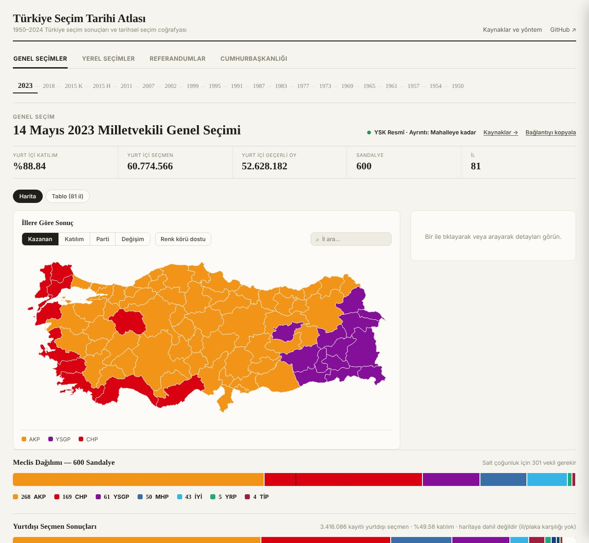

Üst şerit seçim türünü ve yılı seçer; özet kartları (katılım, seçmen, geçerli oy, sandalye) il kayıtlarının toplamından gelir. Sağdaki rozet kaynağı ve ayrıntı düzeyini gösterir: "YSK Resmî · Ayrıntı: Mahalleye kadar".

### 2. Tarihsel ilçe sınırları — `#secim=1977&il=1`


Adana 1977'de bugünkü 15 ilçeyle değil, kendi dönemindeki 13 ilçeyle çizilir. Bugün ayrı olan Aladağ, Yüreğir, Çukurova gibi ilçeler, o tarihte bağlı oldukları ilçenin poligonuna katılmıştır. Rozet kaynağın değiştiğini gösterir: "YSK + TÜİK · Ayrıntı: İlçe".

### 3. Değişim modu — `#secim=2023&mod=degisim&parti=CHP`

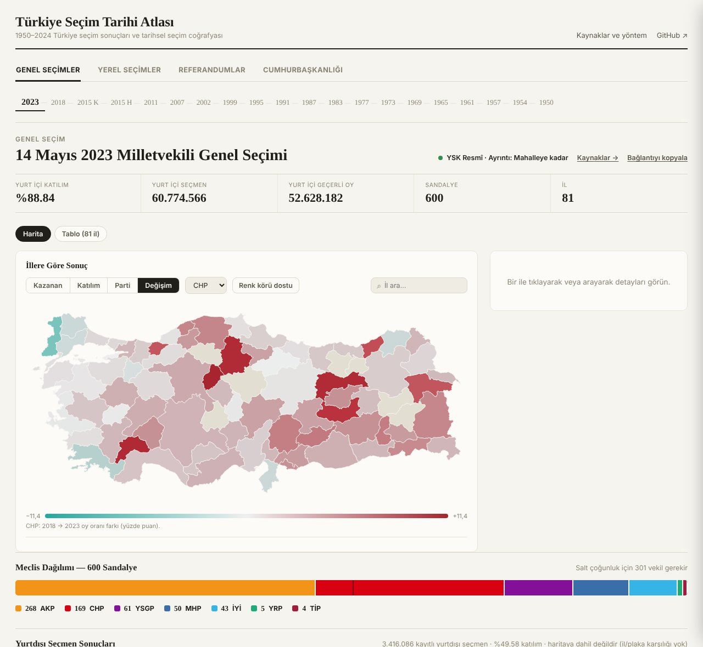

Kırmızı tonlar CHP'nin 2018'e göre kazandığı, karşıt renk kaybettiği illerdir; renk koyulaştıkça fark büyür. Sınırı değişen bir yer karşılaştırılmaz.

### 4. Parti modu, il içi — `#secim=2023&il=6&mod=parti&parti=CHP`

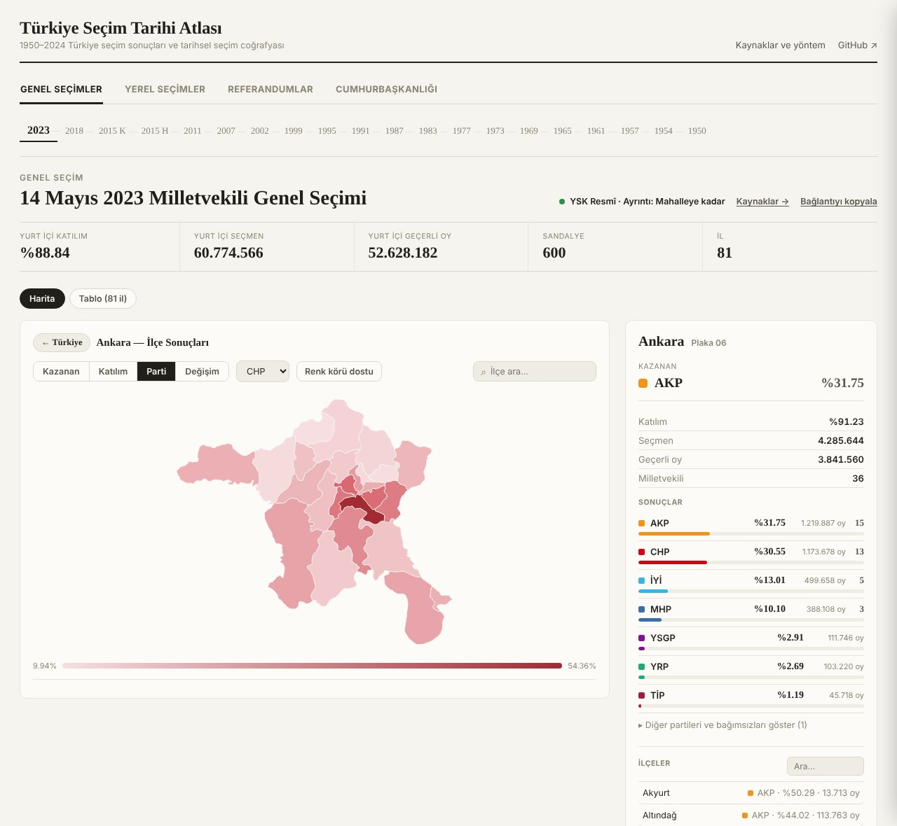

İle inildiğinde ilçeler seçilen partinin oy oranına göre tek renk tonuyla boyanır. Sağ panel ilin sonucunu ve milletvekili dağılımını gösterir.

### 5. Mahalle düzeyi — `#secim=2024yerel&il=6&ilce=TR-D-06-007`

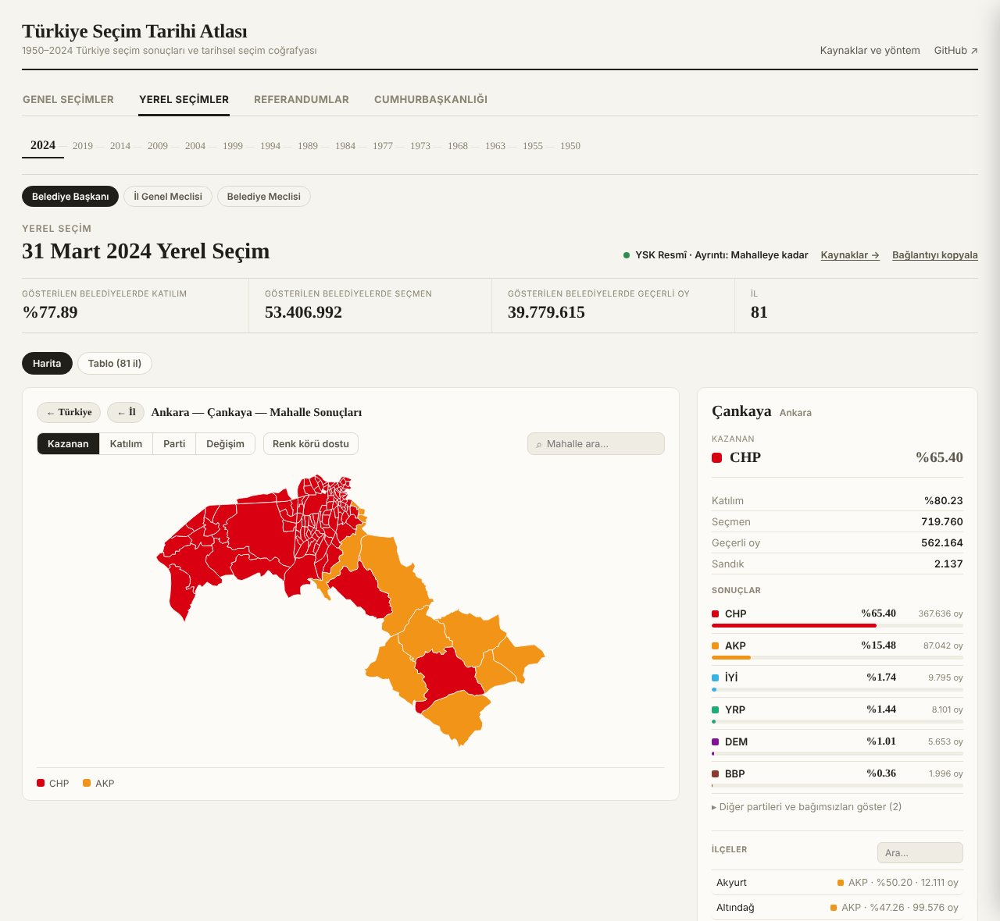

Mahalle poligonları yalnız o ilçeye inildiğinde yüklenir. Oylar YSK API'sinden gelen sandık sonuçlarının mahalle bazında toplamıdır.

### 6. Meclis haritası — `#secim=1984yerel&oylama=bm`

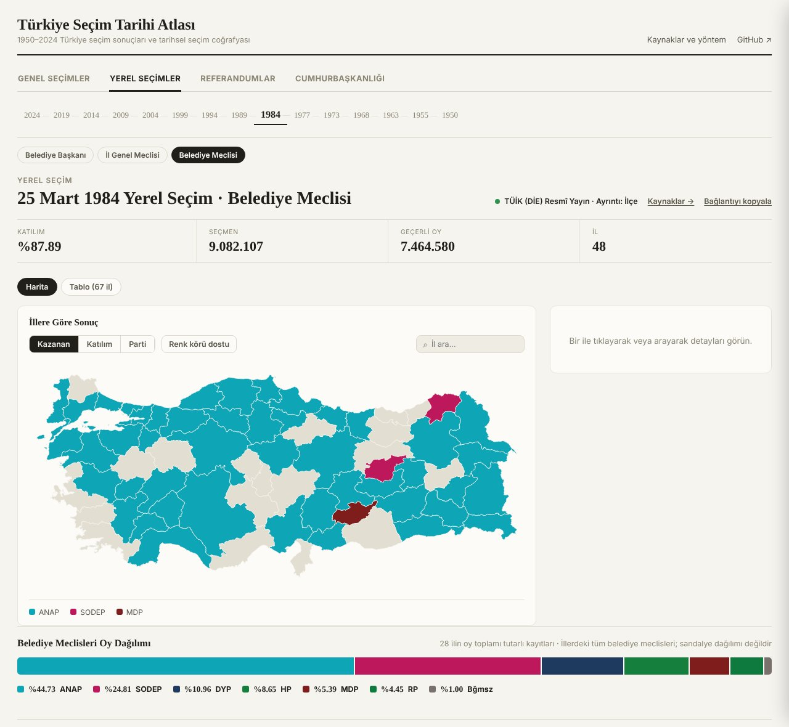

Bu harita taranmış 1984 DİE kitabından dört okumayla çıkarılan satırlarla çizilir. Gri iller, okunan satırın `tutarli` olmadığı ya da hiç okunamadığı yerlerdir; burada tahmin yapılmaz.

### 7. Kaynak kendi içinde tutarsızsa — `#secim=1977&il=1&ilce=TR-D-01-002`

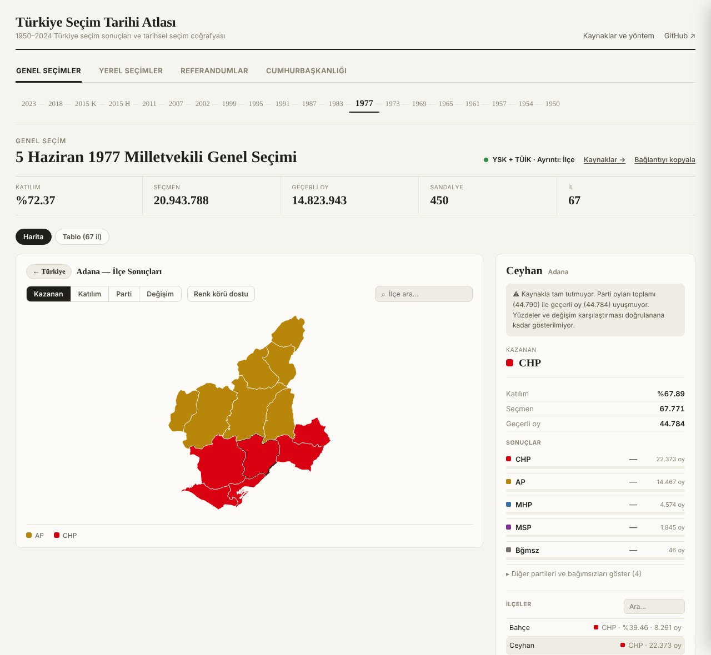

Ceyhan 1977'de parti oyları toplamı (44.790) geçerli oydan (44.784) 6 oy fazla. Site değeri düzeltmez; uyarıyı gösterir ve yüzdeleri doğrulanana kadar gizler. Karşılaştırma bölümündeki "düzeltme yok, not et" kuralının sitedeki karşılığı budur.

### 8. Seçim geçmişi — `#secim=2023&il=1&ilce=TR-D-01-001`

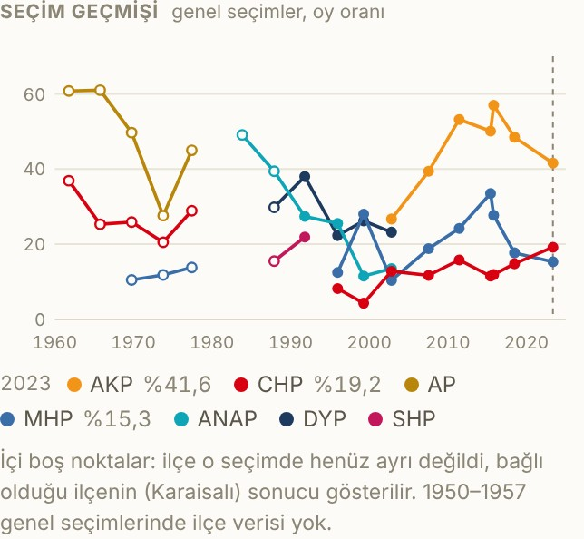

Aladağ 1987'de kurulduğu için 1961–1983 noktaları Karaisalı'nın sonucudur ve içi boş çizilir; not bunu açıkça söyler. Kesik dikey çizgi bakılan seçimi (2023) gösterir.

### 9. Yan yana karşılaştırma — `#secim=2023&il=1&karsi=1977`

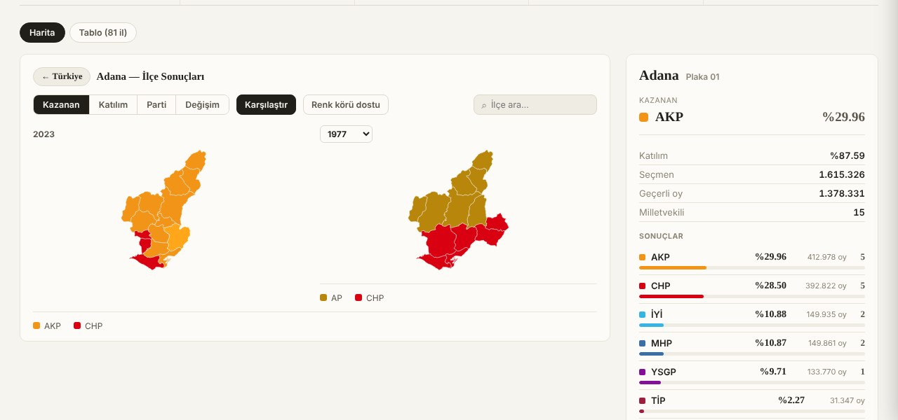

İki harita aynı izdüşümle çizilir: 1977 Adana Osmaniye'yi de içerir, ama ortak ilçeler iki haritada aynı yerdedir. Sağdaki seçim üstündeki listeden değiştirilir.

### 10. Habere gömülmüş harita — `&gom=1&tema=acik`

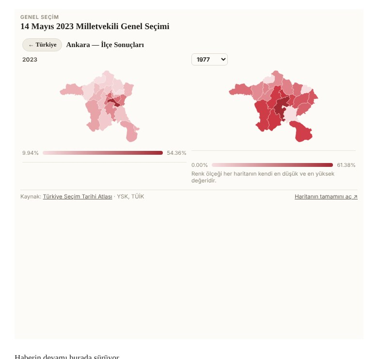

Örnek bir haber sayfasındaki iframe: yalnız başlık, iki harita, lejantlar ve kaynak satırı görünür. "Haritanın tamamını aç" aynı görünümü sitede açar.

### 11. Açık veri sayfası — `veri.html`

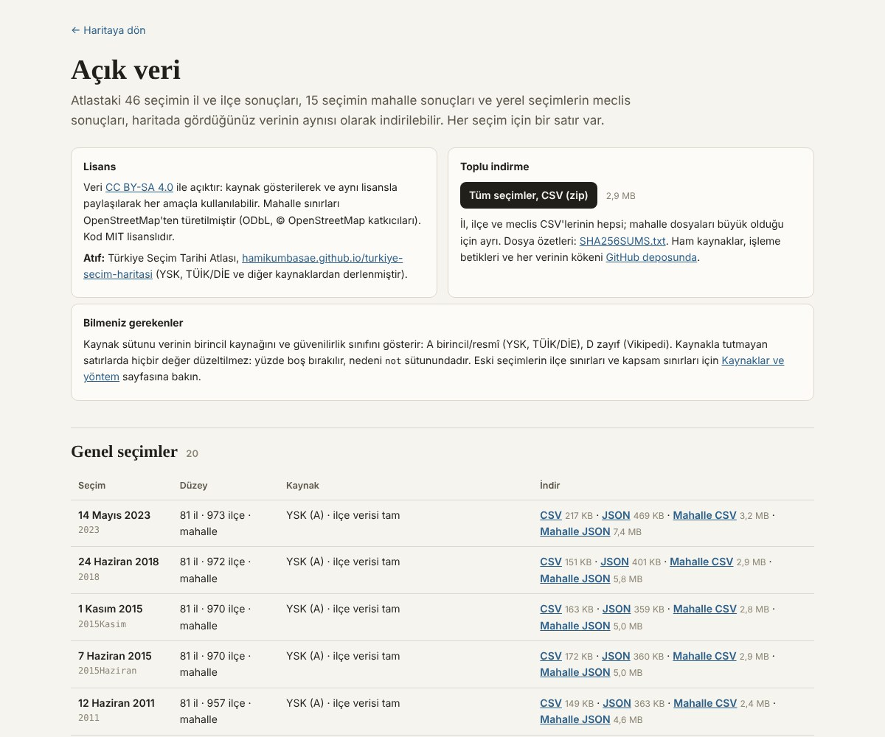

Üstte lisans, atıf ve toplu indirme; altta her seçim için bir satır, dosya boyutlarıyla.

### 12. Paylaşım önizlemesi — `onizleme.png`

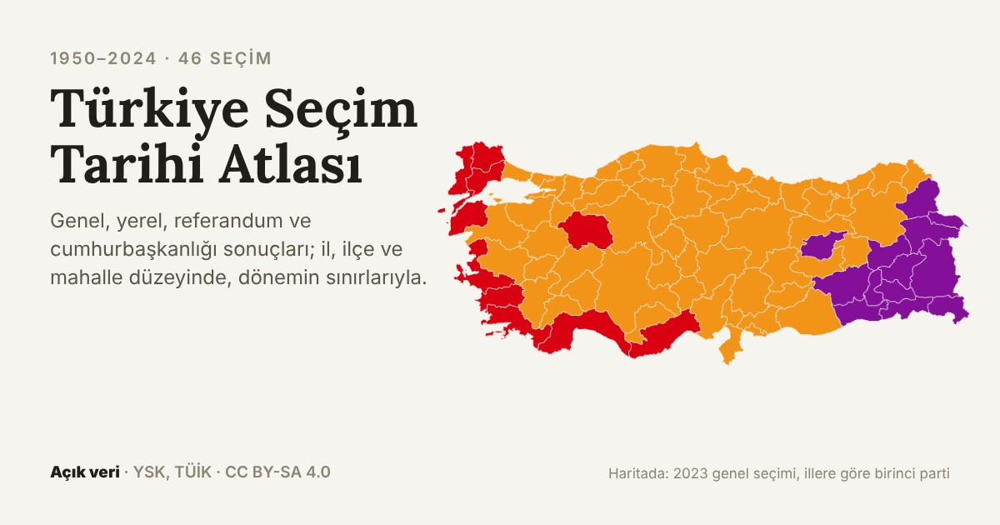

Bağlantı WhatsApp, X ya da LinkedIn'de paylaşılınca bu görsel, başlık ve açıklamayla birlikte görünür.

## Baştan üretme ve dosya haritası

Veriye dokunan her değişiklik aynı sırayla ilerler: önce ham kaynak, sonra hat, en son derleme ve kontroller. Sıra atlanırsa checksum ya da senkron kontrolü CI'da durdurur.

1. Kurulum: `pip install -r requirements.txt`; site testleri için `cd site && npm ci`.
2. Yeni kaynak dosyasını değiştirmeden `data/raw/<kaynak>/` altına koy ve klasörün `PROVENANCE.md`'sine nereden, ne zaman indirildiğini yaz.
3. O kaynağın hattını çalıştır; örneğin TÜİK ilçe raporları için `python3 scripts/pipelines/genel_ilce_1961_1987/fetch_tuik_ilce.py`, ardından aynı klasördeki `merge_into_normalized.py`.
4. İlçe eşlemesi ya da sınır etkilendiyse: `python3 scripts/pipelines/historical_geo/tarihsel_sinirlari_uret.py`.
5. Kapsam raporunu yenile: `python3 scripts/rapor/kapsam_tablosu.py`.
6. Checksum'ları yenile: `python3 scripts/regenerate_checksums.py <klasör>`.
7. Derle: `python3 scripts/build.py` (önce `validate.py` çalışır, hata derlemeyi durdurur).
8. Kontrol et: `python3 tests/validate_elections.py`, `cd tests && node --test`, `cd site && npm test`.
9. `index.html` ile birlikte commit'le ve push'la; CI kontrolleri çalıştırır, main'e birleşince Pages sitesi güncellenir.

### Hangi soru, hangi dosya

| Soru | Bakılacak yer |
| --- | --- |
| Bu ilçenin bu sayısı nereden geldi? | `python3 scripts/kaynak.py <seçim> <il> <ilçe>` |
| Bir seçimin kapsamı ve kalite sınıfı ne? | `docs/rapor/KAPSAM_TABLOSU.md` |
| Bir kaynak nerelerde arandı, neden bulunamadı? | `data/kaynaklar/ARASTIRMA_KAYDI.md` |
| Hangi kitaplar henüz indirilmedi? | `data/kaynaklar/INDIRILECEK_KAYNAKLAR.md` |
| Bir ilçe neden şu eski ilçenin poligonunda? | `geo/historical/idari/ilce_eslesme/<seçim>.csv` |
| Bir kitabın hangi tablosu hangi sayfada, nasıl okundu? | `data/raw/tuik/mahalli-kitap/PROVENANCE.md` |
| Bir seçimin birincil ve yedek kaynağı, bilinen sorunları? | `sources.yml`, `SOURCES.md` |
| Seçim geçmişi grafiğindeki bir nokta nereden geliyor? | `scripts/gecmis.py` → `data/gecmis/genel.json` |
| Açık veri dosyaları nasıl üretiliyor, Pages sitesi nasıl derleniyor? | `scripts/acik_veri.py`; `python3 site/build.py` → `site/dist/` |
| Kapsam dışı bırakılanlar neler? | `README.md`, "Kapsam dışı bırakılanlar" bölümü |
| Projenin ilk görev tanımı | `docs/arsiv/YAPILACAKLAR.md` |
